# Dokumentasi Teknis — Autorespond WhatsApp “Marasa by BPS Sulbar”

> Dokumen ini dibuat dari pembacaan seluruh kode di folder `api-data`. **Tidak ada file kode yang diubah.**
> Fokus dokumen: siapa memanggil siapa, data apa yang dikirim, ke mana request pergi, dan **kolom database mana yang diisi**.

---

## Daftar Isi

1. [Ringkasan Sistem](#1-ringkasan-sistem)
2. [Peta File dan Tanggung Jawab](#2-peta-file-dan-tanggung-jawab)
3. [Alur Pesan Masuk: Wablas → FastAPI → Database](#3-alur-pesan-masuk-wablas--fastapi--database)
4. [Menu Layanan, Registrasi, dan Penyimpanan Pesan](#4-menu-layanan-registrasi-dan-penyimpanan-pesan)
5. [Worker AI dan `main_chat`](#5-worker-ai-dan-main_chat)
6. [Pipeline RAG (LangGraph)](#6-pipeline-rag-langgraph)
7. [Integrasi Wablas](#7-integrasi-wablas)
8. [Database: Skema, Relasi, dan Pemetaan Kolom](#8-database-skema-relasi-dan-pemetaan-kolom)
9. [Pipeline Ingest Data (Populate)](#9-pipeline-ingest-data-populate)
10. [Konfigurasi, Cara Menjalankan, dan Batas Operasional](#10-konfigurasi-cara-menjalankan-dan-batas-operasional)
11. [Cheat Sheet “Siapa Memanggil Siapa”](#11-cheat-sheet-siapa-memanggil-siapa)
12. [Temuan Teknis dan Catatan Keamanan](#12-temuan-teknis-dan-catatan-keamanan)
13. [Contoh Trace Lengkap Satu Pertanyaan](#13-contoh-trace-lengkap-satu-pertanyaan)
14. [Glosarium](#14-glosarium)

---

## 1. Ringkasan Sistem

Aplikasi ini adalah **autoresponder WhatsApp** untuk layanan **Marasa by BPS Provinsi Sulawesi Barat**. Pesan masuk dari WhatsApp melalui **Wablas**, diterima oleh **FastAPI**, lalu diproses menjadi salah satu dari tiga alur layanan:

| Kode `layanan` | Nama Layanan | Penanganan |
|---|---|---|
| `0` | Belum memilih | Dikirim menu pilihan layanan. |
| `1` | Konsultasi Statistik | Pesan user disimpan untuk ditangani petugas. Tidak ada balasan AI. |
| `2` | Pengaduan | Masuk ke worker AI/RAG (sama seperti layanan 3). **Tidak membuat tiket** pada kode saat ini. |
| `3` | Chat AI Statistik | Worker AI/RAG menjawab otomatis, lalu mengirim jawaban via Wablas. |

### 1.1 Komponen utama

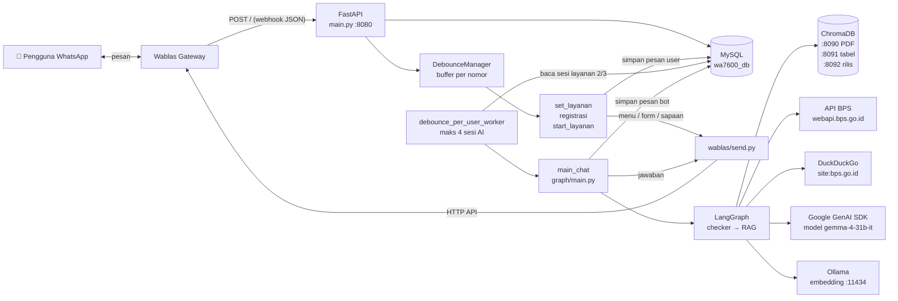

### 1.2 Teknologi yang dipakai

| Lapisan | Teknologi |
|---|---|
| Web server | FastAPI + Uvicorn |
| WhatsApp gateway | Wablas REST API (`tegal.wablas.com`) |
| Database | MySQL, diakses async dengan `peewee` + `peewee-async` |
| Orkestrasi AI | LangGraph (`StateGraph`) |
| LLM | `google-genai` → `genai.Client`, model `gemma-4-31b-it` |
| Embedding | Ollama `nomic-embed-text-v2-moe` |
| Vector store | ChromaDB (3 instance/port) |
| Sumber data | API BPS `webapi.bps.go.id`, PDF publikasi/BRS, tabel statistik, DuckDuckGo |
| Cache | `diskcache` (`shared_cache`, `web_api_cache`) |
| Logging | `loguru` (rotasi harian, retensi 30 hari) |
| Ingestion | `langchain-chroma`, `PyPDFLoader`, `RecursiveCharacterTextSplitter`, `pdf2image` |

### 1.3 Perjalanan satu pesan (ringkas)

```text
Wablas
  └─ POST /  ──────────────────────────────► main.py :: wablas()
       ├─ filter grup / nomor / kosong / duplikat
       └─ debounce.push(phone, payload)
            └─ (tunggu 2 detik tanpa pesan baru)
                 └─ DebounceManager.process()
                      ├─ set_layanan()      → buat sesi / pilih layanan / kirim menu
                      ├─ registrasi()       → kirim form / simpan user baru
                      ├─ start_layanan()    → kirim sapaan layanan
                      └─ ChatMessage(role="user")  → simpan pertanyaan
                           │
                           ▼
             debounce_per_user_worker()  (tiap 1 detik, maks 4 sesi)
                      └─ main_chat()
                           ├─ graph.ainvoke()  → checker → RAG → jawaban
                           ├─ send_simple_text / send_simple_image → Wablas
                           └─ ChatMessage(role="bot") → simpan jawaban
```

### 1.4 Ringkasan database (yang paling sering dicari)

| Tabel | Satu baris mewakili | Kolom kunci | Kapan ditulis |
|---|---|---|---|
| `chatsession` | Satu sesi percakapan untuk satu nomor. | `phone`, `layanan`, `is_done` | Saat pesan pertama / pilih layanan / sesi ditutup. |
| `chatmessage` | Satu pesan dalam sesi. | `session_id`, `role`, `content` | Saat pesan user masuk ke tahap simpan, dan saat bot menjawab. |
| `user` | Identitas user yang sudah registrasi. | `notelp`, `email`, `nama_lengkap` | Saat form identitas valid. |
| `ticket` | Tiket pengaduan. | `user_id` (berisi `notelp`), `content` | **Tidak pernah**, karena `create_ticket()` tidak dipanggil. |

Alur singkat kolom:

```text
Pesan pertama
  → INSERT chatsession(phone, layanan=0, is_done=0, ...)

Pilih "3 Chat AI"
  → UPDATE chatsession SET layanan=3

Pertanyaan user
  → INSERT chatmessage(session_id, role='user', content=pertanyaan)

Jawaban AI
  → INSERT chatmessage(session_id, role='bot', content=jawaban)
     (untuk gambar: content = "path/gambar.jpg teks referensi")

User bilang "terima kasih" / minta admin / di luar topik
  → UPDATE chatsession SET is_done=1
```

---

## 2. Peta File dan Tanggung Jawab

```text
api-data/
├── main.py                     # Entry point FastAPI: webhook, debounce, worker, lifespan
├── backend.py                  # CLI: create DB, download, populate, chat terminal
├── _global.py                  # Koneksi 3 ChromaDB, logger, cache diskcache
├── requirements.txt            # Dependensi Python
├── wa7600_db.sql               # Dump MySQL + data contoh
├── wa7600_db_no_data.sql       # Dump skema MySQL tanpa data
├── how to run.txt / note.txt   # Catatan perintah menjalankan
│
├── db/
│   ├── db.py                   # Koneksi MySQL async + BaseModel
│   ├── models.py               # Model User, ChatSession, ChatMessage, Ticket + query
│   ├── init_db.py              # create_tables()
│   ├── model_wablas.py         # Pydantic payload webhook Wablas
│   └── model_rag.py            # Pydantic model hasil RAG + QuestionModel/AnswerModel
│
├── b_graph/                    # “Business graph”: alur sebelum AI
│   ├── set_layanan.py          # Sesi + menu + penentuan layanan
│   ├── registrasi.py           # Form identitas + validasi + simpan User
│   ├── start_layanan.py        # Sapaan setelah layanan dipilih
│   ├── check_working.py        # Jam kerja, hari kerja, tanggal merah
│   └── complaint.py            # create_ticket() — belum dipanggil
│
├── graph/                      # Pipeline AI
│   ├── main.py                 # build_graph(), main_chat(), main_chat_cmd()
│   ├── state.py                # BPSState
│   ├── text.py                 # Prompt form, pembuka, LLM_PROMPT
│   ├── llm.py                  # llm_query(), llm_query_()
│   ├── nodes/
│   │   ├── checker.py          # Klasifikasi PUAS/TANYA/ADMIN/OFF
│   │   ├── rag.py              # 4 node RAG
│   │   └── rerank.py           # Pool API key, chunking, scoring
│   └── rag/
│       └── retriever.py        # ChromaDB, DuckDuckGo, API BPS
│
├── wablas/
│   └── send.py                 # Semua request keluar ke Wablas
│
└── populate/                   # Pipeline ingest knowledge base
    ├── get_embedding_function.py
    ├── download_pdf.py
    ├── api_bps.py              # Skrip uji API BPS (key hardcoded)
    ├── test_rag.py             # Tes contoh (import tidak tersedia)
    └── populate/
        ├── populate_pdf.py
        ├── populate_pdf_list.py
        ├── populate_data.py
        └── populate_image.py
```

| File | Peran utama | Pemanggil utama |
|---|---|---|
| `main.py` | Menerima webhook, debounce, worker AI, tugas idle, health check. | Uvicorn |
| `backend.py` | CLI untuk ingest dan uji chat terminal. | Manual |
| `_global.py` | Membuat koneksi Chroma, logger, cache. | Di-import banyak modul |
| `db/db.py` | Konfigurasi koneksi MySQL dan `BaseModel`. | `db/models.py` |
| `db/models.py` | Definisi tabel dan query sesi/pesan/user. | `main.py`, `b_graph/*`, `graph/*` |
| `db/init_db.py` | Membuat 4 tabel. | `backend.py --create_db` |
| `db/model_wablas.py` | Validasi payload webhook. | `main.py` |
| `db/model_rag.py` | Bentuk data RAG yang mengalir di state. | `graph/*` |
| `wablas/send.py` | Request keluar ke Wablas. | `b_graph/*`, `graph/main.py`, `db/models.py` |
| `b_graph/set_layanan.py` | Sesi, menu, penentuan `layanan`. | `main.py :: process()` |
| `b_graph/registrasi.py` | Form identitas dan insert `user`. | `main.py :: process()` |
| `b_graph/start_layanan.py` | Sapaan awal sesuai layanan. | `main.py :: process()` |
| `b_graph/check_working.py` | Cek jam kerja/libur. | `set_layanan.py` |
| `graph/main.py` | Menjalankan graph dan mengirim jawaban. | Worker AI / CLI |
| `graph/nodes/checker.py` | Klasifikasi niat pesan. | LangGraph |
| `graph/nodes/rag.py` | Ekstraksi pertanyaan, pencarian, rerank, jawaban. | LangGraph |
| `graph/nodes/rerank.py` | Scoring chunk + rotasi API key. | `rag.py`, `retriever.py` |
| `graph/rag/retriever.py` | Query Chroma/DDG/API BPS. | `rag.py` |
| `populate/*` | Membangun knowledge base. | `backend.py` |

---

## 3. Alur Pesan Masuk: Wablas → FastAPI → Database

### 3.1 Endpoint webhook

`main.py:370`

```python
@app.post("/")
async def wablas(data: WablasIncomingMessage):
    ...
```

Wablas mengirim JSON ke URL ngrok, lalu ngrok meneruskan ke `POST /` di FastAPI. Payload divalidasi oleh `WablasIncomingMessage` (`db/model_wablas.py`).

#### Field payload yang dikenali

| Field | Tipe | Wajib | Dipakai untuk |
|---|---|---|---|
| `id` | `str` | ✅ | Deduplikasi pesan. |
| `pushName` | `str` | – | Nama profil WA; dipakai sebagai `user.nama` dan sapaan sebelum registrasi. |
| `isGroup` | `bool` | – | Jika `true`, pesan langsung diabaikan. |
| `group` | objek | – | Detail grup (tidak dipakai). |
| `message` | `str` | – | Isi pesan; disimpan & diproses. |
| `phone` | `str` | ✅ | Nomor pengirim; kunci sesi dan user. |
| `messageType` | `str` | – | Tidak dipakai. |
| `file`, `url`, `mimeType` | `str` | – | Tidak dipakai. |
| `deviceId`, `sender`, `isFromMe` | – | – | Tidak dipakai. |
| `timestamp` | `datetime` | ✅ | Tidak dipakai untuk logika; wajib ada agar validasi lolos. |
| `profileImage` | `str` | – | Tidak dipakai. |

> Field di luar daftar ini diabaikan oleh Pydantic secara default.

### 3.2 Filter dan deduplikasi

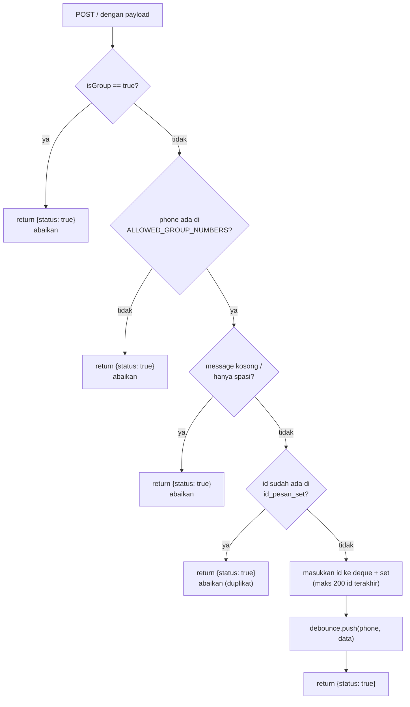

Detail penting:

- Nama `ALLOWED_GROUP_NUMBERS` sebenarnya berisi **daftar nomor HP yang diizinkan**, bukan nomor grup. Nilai default di kode: `6282195195502`.
- Jika variabel ini tidak diisi di `.env`, **hanya nomor `6282195195502` yang diproses**. Nomor lain akan diabaikan tanpa balasan.
- Deduplikasi memakai `id` pesan. Riwayat dedupe hanya 200 ID terakhir dan **hilang saat aplikasi restart**.
- Respons webhook selalu `{"status": true}` agar Wablas tidak mengulang kirim. Proses berat dilakukan di background.
- Pesan yang disimpan dalam database adalah pesan yang penggunanya telah teridentifikasi

### 3.3 Debounce per nomor

`main.py:53–195`

Setiap nomor punya buffer sendiri:

```text
UserBuffer:
  chats   = [payload, payload, ...]
  version = angka versi buffer
  task    = timer asyncio yang sedang berjalan
```

Alur:

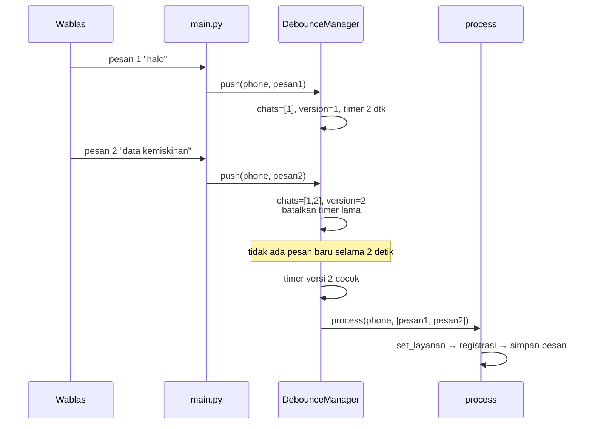

Mekanisme teknis:

1. `push()` mengambil `asyncio.Lock` khusus nomor.
2. Payload ditambahkan ke `buf.chats`.
3. `buf.version` dinaikkan.
4. Timer lama (`buf.task`) dibatalkan.
5. Timer baru dibuat: `asyncio.sleep(2.0)`.
6. Saat timer bangun, ia membandingkan `version` dengan versi buffer. Jika sudah berubah, timer lama berhenti.
7. Jika cocok, buffer diambil, lalu `buffers` dan `locks` dihapus, dan `process()` dijalankan.

> Efeknya: jika user mengetik beberapa pesan beruntun, semuanya digabung menjadi satu batch dan diproses berurutan. Batch berikutnya baru dibuat jika ada pesan baru setelah buffer lama diambil.

### 3.4 `DebounceManager.process()`

`main.py:135`

Ini adalah **inti alur bisnis sebelum AI**:

```python
async def process(self, phone: str, chats: list):
    user = await get_user_by_phone(phone)

    for data in chats:
        session, stop, send_start_layanan = await set_layanan(user, data)
        if stop:
            continue

        user, stop_, send_start_layanan_ = await registrasi(user, session, data)
        if stop_:
            continue

        if send_start_layanan or send_start_layanan_:
            await start_layanan(user, session)
            continue

        await ChatMessage.aio_create(
            session=session,
            role="user",
            content=data.message,
        )
```

Call chain:

```text
process()
├─ get_user_by_phone(phone)                 → SELECT user WHERE notelp = phone
├─ set_layanan(user, data)
│   ├─ get_or_create_active_session(phone)
│   │   ├─ get_active_session(phone)        → SELECT chatsession ...
│   │   └─ ChatSession.aio_create(phone)    → INSERT chatsession
│   ├─ check_work_status()
│   │   ├─ is_working_hours()
│   │   ├─ is_weekday()
│   │   └─ is_holiday()                     → HTTP tanggalmerah.upset.dev
│   └─ send_menu() / send_simple_text()     → HTTP Wablas
├─ registrasi(user, session, data)
│   ├─ extract_form_data()
│   ├─ send_simple_text()                   → HTTP Wablas
│   └─ User.aio_create(...)                 → INSERT user
├─ start_layanan(user, session)             → HTTP Wablas
└─ ChatMessage.aio_create(role="user")      → INSERT chatmessage
```

**Konsekuensi penting:** pesan yang memicu menu, pemilihan layanan, atau pengiriman form **tidak disimpan** ke `chatmessage` karena alur berhenti di `continue`. Yang disimpan sebagai `role = "user"` hanyalah pesan yang sudah melewati semua tahap tersebut.

---

## 4. Menu Layanan, Registrasi, dan Penyimpanan Pesan

### 4.1 `set_layanan()` — sesi dan menu

`b_graph/set_layanan.py:9`

```text
set_layanan(user, message)
├─ phone = message.phone
├─ session, baru = get_or_create_active_session(phone)
├─ work_status, text = check_work_status()
├─ jika baru:
│    send_menu(phone, work_status, nama_lengkap)
│    stop = True
├─ jika pesan mengandung "<~ 1 Konsultasi Statistik":
│    jika di luar jam kerja → kirim "admin tidak aktif", stop = True
│    jika session.layanan == 1 → tutup sesi lama, buat sesi baru
│    session.layanan = 1; save()
│    send_start_layanan = True
├─ jika pesan mengandung "<~ 2 Pengaduan":
│    jika session.layanan == 2 → tutup sesi lama, buat sesi baru
│    session.layanan = 2; save()
│    send_start_layanan = True
├─ jika pesan mengandung "<~ 3 Chat AI Statistik":
│    jika session.layanan == 3 → tutup sesi lama, buat sesi baru
│    session.layanan = 3; save()
│    send_start_layanan = True
└─ jika bukan sesi baru dan session.layanan == 0:
     kirim "silakan pilih layanan", stop = True
```

#### Tabel keputusan

| Kondisi | Aksi | `stop` | `send_start_layanan` |
|---|---|---|---|
| Sesi baru | Kirim menu (`send_menu`) | `True` | `False` |
| Pilih “1 Konsultasi Statistik” dan jam kerja | Set `layanan = 1` | `False` | `True` |
| Pilih “1 Konsultasi Statistik” di luar jam kerja | Kirim pesan admin tidak aktif | `True` | `False` |
| Pilih “2 Pengaduan” | Set `layanan = 2` | `False` | `True` |
| Pilih “3 Chat AI Statistik” | Set `layanan = 3` | `False` | `True` |
| Sesi lama, `layanan = 0`, bukan pilihan menu | Minta pilih layanan | `True` | `False` |

Catatan:

- `check_work_status()` dipanggil **pada setiap pesan**, bukan hanya layanan 1. Hasil `work_status` dipakai untuk menentukan apakah menu menampilkan opsi Konsultasi dan untuk memblokir layanan 1 di luar jam kerja.
- Layanan 2 dan 3 **tidak dibatasi jam kerja**.
- Teks pilihan menu dari Wablas diasumsikan berbentuk `<~ 1 Konsultasi Statistik`, `<~ 2 Pengaduan`, dan `<~ 3 Chat AI Statistik`. Pencocokan dilakukan dengan `in` setelah karakter non-ASCII dibuang.
- Jika user memilih layanan yang sama dengan sesi aktif, sesi lama ditutup (`is_done = 1`), lalu sesi baru dibuat.
- `send_menu` menampilkan opsi Konsultasi hanya jika `work_status == True`.

#### Tabel `chatsession` yang terlibat

| Momen | Operasi SQL | Kolom |
|---|---|---|
| Pesan pertama nomor baru | `INSERT INTO chatsession` | `phone`, `layanan=0`, `use_ai=0`, `is_done=0`, `need_human=0`, `created_at`, `updated_at` |
| Memilih layanan | `UPDATE chatsession SET layanan=?` | `layanan = 1/2/3` |
| Memilih layanan **berbeda** dari sesi aktif | `UPDATE chatsession SET layanan=?` pada baris yang sama | `layanan` berubah; sesi tidak ditutup |
| Memilih layanan **yang sama** dengan sesi aktif | `UPDATE chatsession SET is_done=1` + `INSERT` sesi baru | Sesi lama ditutup, sesi baru `layanan=0` lalu di-set |
| Sesi kedaluwarsa saat lookup (TTL 24 jam) | Tidak ada UPDATE; `get_active_session` menganggap sesi tidak aktif | Lalu `INSERT` sesi baru |
| `close_24_hour()` saat startup | `UPDATE chatsession SET is_done=1` | `is_done` |

### 4.2 `registrasi()` — form identitas

`b_graph/registrasi.py:29`

Registrasi hanya berjalan jika `user is None` (nomor belum ada di tabel `user`).

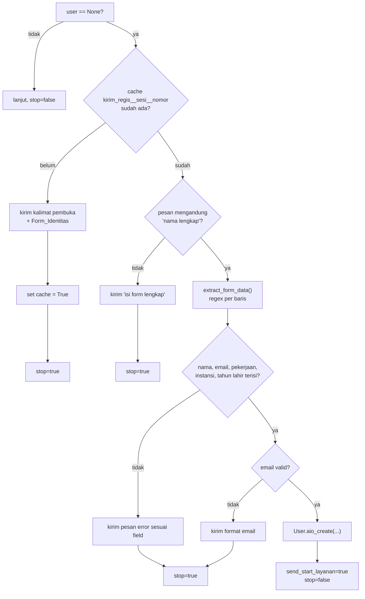

#### Regex form (`FORM_PATTERNS`)

| Field | Pola | Contoh input |
|---|---|---|
| `nama_lengkap` | `^nama\s*lengkap\s*:\s*(.+)$` | `Nama Lengkap : Budi` |
| `email` | `^email\s*:\s*(.+)$` | `Email : budi@bps.go.id` |
| `tahun_lahir` | `^tahun\s*lahir\s*:\s*(\d+)$` | `Tahun Lahir : 1995` |
| `pekerjaan` | `^pekerjaan\s*:\s*(.+)$` | `Pekerjaan : PNS` |
| `instansi` | `^instansi.*?:\s*(.+)$` | `Instansi/Tempat Aktivitas Sehari-hari : BPS` |

Validasi:

- Semua field wajib tidak kosong.
- Email divalidasi dengan `email_validator.validate_email`.
- `tahun_lahir` di-cast ke `int` (tidak ada validasi rentang tahun).
- Jika email sudah dipakai user lain, `INSERT` gagal dan ditangkap oleh `except Exception` → user diminta mengisi form lagi (pesan error generik).

#### Kolom `user` yang diisi

| Kolom | Nilai | Sumber |
|---|---|---|
| `nama` | `message.pushName` | Profil WhatsApp |
| `notelp` | `message.phone` | Nomor pengirim |
| `email` | Form “Email :” | Input user |
| `nama_lengkap` | Form “Nama Lengkap :” | Input user |
| `pekerjaan` | Form “Pekerjaan :” | Input user |
| `instansi` | Form “Instansi/…” | Input user |
| `tahun_lahir` | Form “Tahun Lahir :” | Input user (int) |
| `created_at` | `datetime.now()` | Default model |

> Cache `kirim_regis__{session.id}__{phone}` disimpan di `shared_cache` (diskcache) dan tidak punya masa berlaku. Tujuannya agar form tidak dikirim berulang kali dalam sesi yang sama.

### 4.3 `start_layanan()` — sapaan setelah memilih layanan

`b_graph/start_layanan.py:5`

| `layanan` | Pesan yang dikirim |
|---|---|
| `1` | “Mohon tunggu sebentar Bapak/Ibu … Saya teruskan pesan ini ke petugas kami …” |
| `2` | “Mohon maaf atas ketidaknyamanannya … Silakan sampaikan pengaduan Anda.” |
| `3` | “Halo 👋 Saya asisten virtual 🤖 … Silakan sampaikan pertanyaan Anda.” |

Fungsi ini hanya mengirim WhatsApp. **Tidak menulis ke database.**

### 4.4 Matriks penyimpanan pesan

| Kejadian | `chatsession` | `chatmessage` | `user` |
|---|---|---|---|
| Pesan pertama nomor baru | INSERT (`layanan=0`) | – | – |
| Memilih layanan | UPDATE `layanan` | – | – |
| Form identitas pertama | – | – | – |
| Form identitas valid | – | – | INSERT |
| Pesan biasa (layanan 1) | – | INSERT `role=user` | – |
| Pesan biasa (layanan 2/3) | – | INSERT `role=user` | – |
| Jawaban AI | – | INSERT `role=bot` (satu per item) | – |
| User menyatakan PUAS | UPDATE `is_done=1` | – | – |
| User minta ADMIN | UPDATE `is_done=1` | – | – |
| Pesan di luar topik (OFF) | UPDATE `is_done=1` | – | – |
| Error pipeline AI | UPDATE `is_done=1` | INSERT `role=bot` (permintaan maaf) | – |
| Sesi idle / 24 jam | UPDATE `is_done=1` | – | – |
| Pengaduan | – | Hanya pesan user/bot | – (tiket tidak dibuat) |


  Catatan : 
  - pesan yang disimpan kedalam tabel chatmessage adalah pesan yang usernya telah teridentifikasi oleh apk
---

## 5. Worker AI dan `main_chat`

### 5.1 Worker pemilih sesi

`main.py:218` — berjalan terus-menerus, loop setiap **1 detik**.

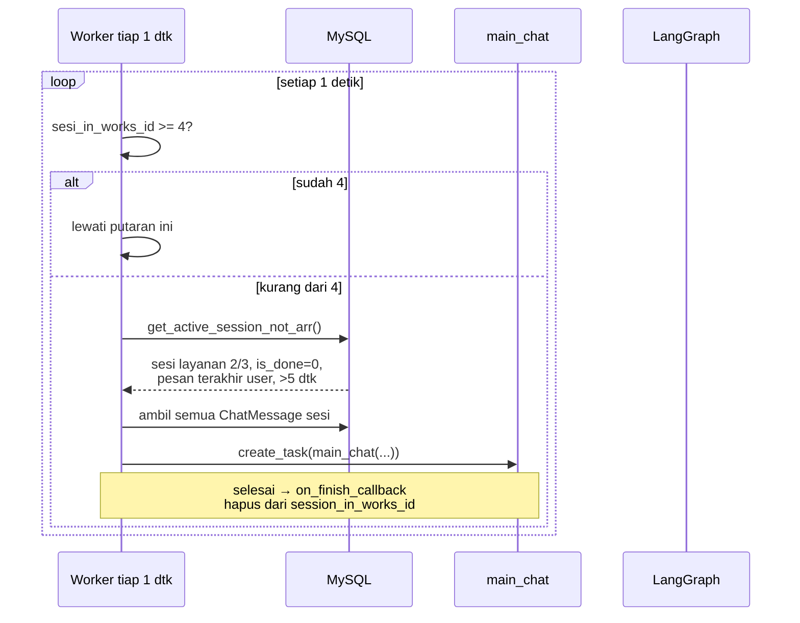

Syarat sesi yang diambil (`db/models.py:144`):

```text
(layanan == 2 OR layanan == 3)
AND is_done == 0
AND ChatMessage.id IN (SELECT MAX(id) GROUP BY session)
      → pesan terakhir sesi
AND role == 'user'
AND created_at < now - 5 detik
AND id NOT IN session_in_works_id
```

Tujuan syarat 5 detik: memberi jeda agar user selesai mengetik dan debounce selesai.

Batas konkurensi: `session_in_works_id` adalah `set()` in-memory. Jika sudah berisi **4 sesi**, worker tidak mengambil sesi baru. Set ini hilang saat restart.

### 5.2 Cara riwayat dipisah

`main.py:243–265`

```python
all_messages = list(
    await ChatMessage.select()
    .where(ChatMessage.session == session)
    .order_by(ChatMessage.created_at)
    .aio_execute()
)
all_messages.reverse()
```

Setelah `reverse()`, urutan menjadi **terbaru → terlama**. Lalu:

```text
new_message   = pesan user setelah balasan bot terakhir
older_message = balasan bot terakhir + semua pesan yang lebih lama
```

Contoh:

```text
Isi DB (lama → baru): user A, bot B, user C, user D
Setelah reverse    : D, C, B, A

new_message   = [D, C]          # urutan terbaru → terlama
older_message = ["bot : B", "user : A"]
```

> Catatan: `new_message` berisi pesan terbaru lebih dulu. `checker` mengambil `new_chat[-1]`, sehingga yang dipakai sebagai “pesan terakhir” justru **pesan paling lama dalam batch**. Ini dibahas di bagian temuan.

### 5.3 `main_chat()` — menjalankan graph dan mengirim jawaban

`graph/main.py:47`

```text
main_chat(graph, session, message, chat_history)
├─ user = get_user_by_phone(session.phone)
├─ state = {
│    type: "WA", check: "TANYA",
│    nama, nama_lengkap, notelp,
│    question: [],
│    new_chat: message,
│    chat_history: chat_history
│  }
├─ result = await graph.ainvoke(state)
│
├─ jika result.check == "PUAS":
│    send_simple_text("Terima kasih ...")
│    session.is_done = True; save()
│    return
├─ jika result.check == "ADMIN":
│    send_simple_text("Siap, kak ... hubungkan dengan petugas ...")
│    session.is_done = True; save()
│    return
├─ jika result.check == "OFF":
│    send_simple_text("... di luar topik statistik BPS ...")
│    session.is_done = True; save()
│    return
│
├─ (TANYA) susun daftar answer dari result.question[].answer[]
├─ tambahkan disclaimer "*AI dapat membuat kesalahan"
├─ untuk setiap answer:
│    ├─ jika file_path == None → send_simple_text
│    └─ jika file_path ada   → send_simple_image (deduplikasi path)
│    └─ sleep 3 detik
│
├─ untuk setiap answer di result.question[].answer:
│    └─ ChatMessage.aio_create(role="bot", content=...)
│
└─ jika exception:
     ChatMessage.aio_create(role="bot", content="Mohon maaf, terjadi kendala ...")
     send_simple_text("Mohon maaf, terjadi kendala ...")
     session.is_done = True; save()
```

#### Format pengiriman

- Satu pertanyaan: teks jawaban dikirim apa adanya.
- Lebih dari satu pertanyaan: prefix `Pertanyaan :\n{index}. {ques}\n\n{jawaban}`. `index` dimulai dari `0`.
- Untuk gambar: `send_simple_image(phone, caption, file_path)`. Jika ada beberapa pertanyaan, caption juga memakai prefix pertanyaan.
- Path gambar yang sama tidak dikirim dua kali (`path_ori`).
- Jeda **3 detik** antar item agar urutan pesan terjaga dan tidak kena rate limit Wablas.

#### Apa yang disimpan sebagai `chatmessage`

| Jenis answer | Isi `content` |
|---|---|
| Teks | Teks jawaban. |
| Gambar referensi | `"{file_path} {teks}"` (path lokal di awal). |
| Disclaimer | **Tidak disimpan** (hanya dikirim ke WA). |
| Pesan penutup PUAS/ADMIN/OFF | **Tidak disimpan**. |
| Pesan error | Disimpan sebagai `role=bot`. |

### 5.4 `main_chat_cmd()` — mode terminal

`graph/main.py:140` dipakai oleh `backend.py --start_chat`. Fungsinya sama untuk menjalankan graph, tetapi:

- `type = "cmd"`, `nama`/`notelp` kosong.
- Tidak mengirim WhatsApp.
- Tidak menyimpan `chatmessage`.
- Mengembalikan daftar `AnswerModel` untuk dicetak di terminal.

---

## 6. Pipeline RAG (LangGraph)

### 6.1 State yang mengalir

`graph/state.py`

| Field | Isi | Dipakai |
|---|---|---|
| `type` | `"WA"` atau `"cmd"` | Menentukan apakah mengirim WhatsApp. |
| `check` | `PUAS` / `TANYA` / `ADMIN` / `OFF` | Hasil klasifikasi. |
| `nama` | `user.nama` | Konteks. |
| `nama_lengkap` | `user.nama_lengkap` | Konteks. |
| `notelp` | `session.phone` | Kirim WhatsApp. |
| `user_is_db` | – | Dideklarasikan, tidak dipakai. |
| `use_ai` | – | Dideklarasikan, tidak dipakai. |
| `question` | `list[QuestionModel]` | Hasil ekstraksi & RAG. |
| `new_chat` | `list[str]` | Pesan user batch terbaru. |
| `chat_history` | `list[str]` | Riwayat percakapan berprefix. |

### 6.2 Bentuk graph

`graph/main.py:21`

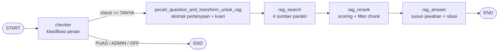

### 6.3 Node 1 — `checker`

`graph/nodes/checker.py:9`

| Kondisi | Perilaku |
|---|---|
| `chat_history` kosong (interaksi AI pertama) | Tidak memanggil LLM. `check` tetap `TANYA` (nilai awal state). Kirim pesan “Mohon tunggu … 1–10 menit”. |
| `chat_history` tidak kosong | LLM diminta menjawab **satu kata**: `PUAS`, `TANYA`, `ADMIN`, atau `OFF`. |
| Hasil `TANYA` dan `type == "WA"` | Kirim pesan “Mohon tunggu …”. |
| Hasil bukan salah satu kata | Ulangi maksimal 4 kali, lalu raise exception. |

Kategori:

| Kategori | Arti |
|---|---|
| `PUAS` | User berterima kasih / menyatakan cukup / mengakhiri percakapan. |
| `TANYA` | Pertanyaan statistik, metodologi, atau layanan BPS. |
| `ADMIN` | User eksplisit minta manusia/admin/CS/staf. |
| `OFF` | Di luar konteks BPS, ofensif, spam, atau melanggar kebijakan. |

> Jika `chat_history` kosong, pesan pertama **selalu** dianggap `TANYA`, termasuk jika isinya “terima kasih” atau “mau bicara dengan admin”.

### 6.4 Node 2 — ekstraksi pertanyaan

`graph/nodes/rag.py:17`

LLM diminta mengubah teks user (dan riwayat) menjadi **array JSON**. Setiap item:

```json
{
  "pertanyaan_asli": "Pertanyaan yang sudah dirapikan, memakai istilah resmi BPS, ditambah wilayah dan tahun bila kosong",
  "kueri_pencarian": [
    "variasi kueri pencarian 1",
    "variasi kueri pencarian 2"
  ],
  "keyword": ["kata", "kunci", "tunggal"]
}
```

Aturan prompt yang penting:

- Istilah awam diterjemahkan ke istilah resmi BPS (mis. “pengangguran” → “Tingkat Pengangguran Terbuka”).
- Jika wilayah tidak disebut → tambahkan **“Sulawesi Barat”**.
- Jika waktu tidak disebut → tambahkan **“2025” dan “2026”**.
- Pertanyaan multi-indikator dipecah menjadi beberapa objek.
- `keyword` harus **satu kata per item**; frasa dipecah.
- Rentang tahun dijabarkan menjadi tahun-tahun individual.
- Output harus JSON murni; `clean_json_string()` membuang pagar blok kode markdown (mis. pembuka `json`).

Hasilnya:

```python
QuestionModel(
    ques=pertanyaan_asli,
    rag_ques=kueri_pencarian,
    keyword=keyword
)
```

disimpan ke `state["question"]`.

### 6.5 Node 3 — pencarian paralel

`graph/nodes/rag.py:211`

Untuk **setiap pertanyaan**, empat task dijalankan paralel dengan `asyncio.gather`:

```text
tasks = [
  get_ddgs_arr(query),
  get_rag_data_arr(query, keywords, 8),
  get_rag_data_table_arr(query, keywords, 3),
  get_rag_rilis_publikasi(query, keywords, 5),
  ... (4 task lagi untuk pertanyaan berikutnya)
]
```

Hasil dipetakan kembali berdasarkan `index * 4`:

| Urutan | Fungsi | Hasil disimpan ke |
|---|---|---|
| 1 | `get_ddgs_arr` | `question[i].ddgs` |
| 2 | `get_rag_data_arr` | `question[i].rag_publikasi_brs` |
| 3 | `get_rag_data_table_arr` | `question[i].rag_data` |
| 4 | `get_rag_rilis_publikasi` | `question[i].rag_rilis_publikasi` |

#### Sumber data dan parameternya

| Sumber | Fungsi | Vector store / API | Metode | `k` | Filter |
|---|---|---|---|---|---|
| Isi PDF publikasi & BRS | `get_rag_data_arr` | Chroma `:8090` (`vectorstore_isi_pdf`) | MMR (`amax_marginal_relevance_search`) | `8` per kueri, `fetch_k=40`, `lambda=0.5` | `where_document` membuang daftar isi/tabel/gambar/pustaka; lalu filter keyword |
| Deskripsi/tabel statistik | `get_rag_data_table_arr` | Chroma `:8091` (`vectorstore_table`) | MMR | `3` per kueri, `fetch_k=15`, `lambda=0.5` | filter keyword |
| Abstrak rilis/publikasi | `get_rag_rilis_publikasi` | Chroma `:8092` (`vectorstore_rilis_publikasi`) | similarity search with score | `5` per kueri | filter keyword |
| Web BPS | `get_ddgs_arr` | DuckDuckGo `site:bps.go.id` + fetch halaman | pencarian web + `BeautifulSoup` | hasil web | – |
| Tabel BPS (live) | `get_content_rag_data_table_tahun` | `webapi.bps.go.id` | HTTP | – | tahun dari keyword |

#### Detail retriever

**`get_rag_data_arr`** (`graph/rag/retriever.py:45`)

1. Untuk setiap kueri, lakukan MMR search di `:8090`.
2. Kumpulkan semua hasil.
3. Untuk setiap dokumen, ambil **isi penuh halaman** lewat `get_content_rag_data_by_halaman(source, page)`.
4. Bangun `RagPublikasiBRS`:
   - `id` = UUID baru.
   - `bps_id` = metadata `pub_id` / `brs_id`.
   - `type` = `pub` / `brs`.
   - `halaman` = dari ID chunk (`path:page:index`) + 1.
   - `content` = isi penuh halaman (bukan hanya chunk).
   - `file_path` = path gambar halaman (`.../IMAGES/.../{page+1}.jpg`).
   - `score = 1` (skor awal; nanti diganti hasil rerank).
5. Hanya dokumen yang memuat salah satu `keyword` (substring, case-insensitive) yang dimasukkan.
6. Deduplikasi berdasarkan `source -+- page`.

**`get_rag_data_table_arr`** (`graph/rag/retriever.py:129`)

- MMR di `:8091`.
- Membentuk URL tabel:
  `https://sulbar.bps.go.id/id/statistics-table/{sumber}/{table_id}/data.html`
- `RagData(id, judul, url, sumber, table_id, content, score=1)`.

**`get_rag_rilis_publikasi`** (`graph/rag/retriever.py:202`)

- `similarity_search_with_score` di `:8092`.
- `score` dari Chroma adalah jarak (semakin kecil semakin mirip), tetapi nilai ini **ditimpa** oleh skor LLM saat rerank.
- `RagRilisPublikasi(id, tipe, bps_id, rl_date, content, score)`.

**`get_ddgs_arr`** (`graph/rag/retriever.py:231`)

- Query: `site:bps.go.id {', '.join(query)}`.
- Untuk setiap hasil, ambil isi halaman dengan `aiohttp` + `BeautifulSoup`, maksimal 4.000 karakter.
- Jika fetch gagal, pakai `snippet` dari hasil pencarian.
- Retry maksimal 2 kali dengan jeda 2 detik.

**Filter `where_document`** (`search_filter`)

Membuang halaman yang memuat teks seperti:

- `daftar isi`, `daftar tabel`, `daftar gambar`, `daftar pustaka` (berbagai kapitalisasi)
- deretan titik `........`
- `Halaman Page`

Tujuannya agar chunk daftar isi tidak ikut dinilai.

### 6.6 Node 4 — rerank dan scoring

`graph/nodes/rag.py:272` + `graph/nodes/rerank.py`

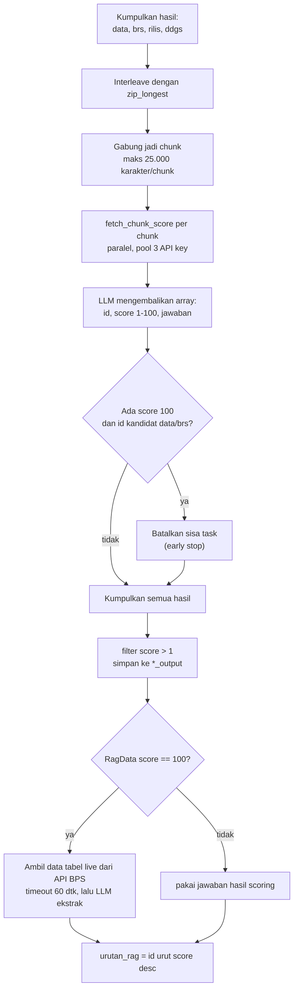

#### Aturan skor dari prompt

| Skor | Arti |
|---|---|
| `100` | Indikator sama, periode sama, dan chunk menjawab utuh. |
| `1–99` | Relevan sebagian; skor turun proporsional. |
| Tidak masuk output | Indikator berbeda, periode berbeda, hanya daftar isi, redundan, atau tidak memuat fakta. |

#### Chunking untuk LLM

`append_chunk()` (`graph/nodes/rerank.py:38`) menggabungkan teks hasil `print()` dari setiap model. Jika penambahan melebihi **25.000 karakter**, chunk sebelumnya dimasukkan ke array dan chunk baru dimulai.

#### Pool API key

`APIKeyPool` (`graph/nodes/rerank.py:20`):

- Key diambil dari `Whatsapp7600_03_Api_KEY`, `_05_`, `_06_`.
- Setiap key punya `AsyncLimiter(10, 60)` → maksimal **10 request per 60 detik per key**.
- Key diambil dari `asyncio.Queue`; setelah sukses dikembalikan ke queue.
- Jika error: key dikembalikan setelah **cooldown 20 detik** (background), lalu percobaan diulang maksimal 4 kali dengan jeda 2 detik.
- Jika task dibatalkan karena early stop, key tetap dikembalikan ke queue.

#### Early stop

Jika ada hasil dengan `score == 100` dan `id` termasuk kandidat dari `rag_data` atau `rag_publikasi_brs`, seluruh task chunk yang belum selesai dibatalkan. Ini mempercepat proses, tetapi hasil chunk lain bisa tidak lengkap.

#### Pengayaan data tabel (score 100)

Untuk `RagData` dengan skor 100, `process_rag_data_item()` memanggil:

```text
get_content_rag_data_table_tahun(ques, judul, sumber, table_id, keyword)
├─ ambil tahun dari keyword (1900–2100)
├─ get_detail_table(client, table_id, type=sumber, year_arr)
│   ├─ type 2 → /view/model/tablestatistic/.../id/{id}
│   │            /list/model/th/.../var/{var}
│   │            /list/model/data/.../var/{var}/th/{tahun}
│   └─ type 3 → /view/model/tablestatistic/.../year/{tahun}/id/{id}
├─ json_to_text_2 / json_to_text_3  → teks tabel
├─ potong menjadi chunk
└─ fetch_chunk_jawaban per chunk (LLM plain text)
```

- Timeout keseluruhan: **60 detik**.
- Jika timeout/error: fallback ke jawaban hasil scoring sebelumnya.
- Respons API BPS di-cache 15 menit (`web_api_cache`).

### 6.7 Node 5 — jawaban akhir

`graph/nodes/rag.py:418`

1. Kumpulkan semua `*_output` ke `chunks_dict` berdasarkan `id`.
2. Susun konteks sesuai `urutan_rag` (skor tertinggi lebih dulu).
3. Jika **tidak ada output sama sekali**:
   - Jawab `"Maaf, kami belum menemukan data yang sesuai."`
   - Lanjut ke pertanyaan berikutnya.
4. Jika ada output:
   - LLM dipanggil dengan `LLM_PROMPT` (`graph/text.py`).
   - Respons wajib JSON:
     ```json
     {
       "jawaban": "Jawaban berbasis konteks",
       "sitasi": ["id_string_1", "id_string_2"]
     }
     ```
5. Untuk setiap `sitasi` yang ada di `chunks_dict` dan bertipe `RagPublikasiBRS`:
   - Tambahkan `AnswerModel(type="file", text="Referensi Dokumen: {title}, Hal {halaman}", file_path=...)`.
6. Tambahkan `AnswerModel(type="text", text=jawaban, sitasi=sitasi)`.

#### Prompt `LLM_PROMPT`

Aturan utama:

- Jawab **hanya** dari `CONTEXT`.
- Jika tidak ada di konteks → `"Data tidak ditemukan dalam sumber yang tersedia."`
- Jangan menebak angka.
- Jangan menggabungkan angka menjadi kesimpulan baru.
- Pilih data terbaru; utamakan sumber resmi.
- Wajib menyertakan `id` sumber yang benar-benar dipakai.
- Format jawaban: ringkas, profesional, langsung ke inti.
- Jika diminta analisis, tambahkan maksimal 3 kalimat (tren, perbandingan, insight).
- Jangan menyebut kata “context”.

#### Pemanggilan LLM

| Tahap | Fungsi | API key env | Timeout | Retry | Output |
|---|---|---|---|---|---|
| Klasifikasi | `checker` → `llm_query` | `Whatsapp7600_01_Api_KEY` | 60 dtk | 4× | Satu kata |
| Ekstraksi pertanyaan | `pecah_question...` → `llm_query` | `Whatsapp7600_02_Api_KEY` | 60 dtk | 4× + jeda 10 dtk | Array JSON |
| Rerank/scoring | `fetch_chunk_score` → `llm_query` | pool `_03_`, `_05_`, `_06_` | 60 dtk | 4× + cooldown 20 dtk | Array JSON |
| Ekstraksi tabel live | `fetch_chunk_jawaban` → `llm_query_` | pool yang sama | 30 dtk | 4× | Teks biasa |
| Jawaban akhir | `rag_answer` → `llm_query` | `Whatsapp7600_04_Api_KEY` | 60 dtk | 4× + jeda 10 dtk | Objek JSON |

Semua memakai `genai.Client(api_key=...)` dan model `"gemma-4-31b-it"` yang di-hardcode di `graph/llm.py`.

### 6.8 Sequence diagram RAG

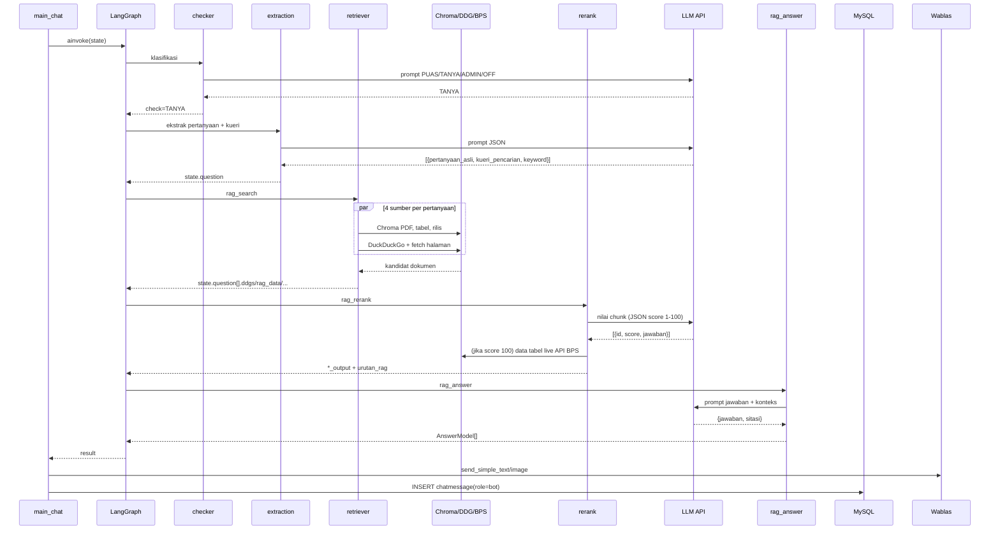

---

## 7. Integrasi Wablas

Semua request keluar ada di `wablas/send.py`.

| Fungsi | Dipakai oleh | Metode | Endpoint | Autentikasi | Body/Query |
|---|---|---|---|---|---|
| `send_simple_text` | `checker`, `main_chat`, `set_layanan`, `registrasi`, `start_layanan` | `GET` | `https://tegal.wablas.com/api/send-message` | query `token = TOKEN.SECRET` | `phone`, `message`, `flag=instant` |
| `send_simple_image` | `main_chat` (sitasi gambar) | `POST` form | `https://tegal.wablas.com/api/send-image-from-local` | header `Authorization: TOKEN.SECRET` | `phone`, `caption`, `file` (base64), `data` (JSON metadata file) |
| `send_menu` | `set_layanan` (sesi baru) | `POST` JSON | `https://tegal.wablas.com/api/v2/send-list` | header `Authorization` | `data[].phone`, `data[].message` (title, description, buttonText, lists, footer) |
| `send_end_session` | `iddle_task_ai` | `GET` | `https://tegal.wablas.com/api/send-message` | query `token` | `phone`, `message`, `flag=instant` |

### 7.1 Contoh bentuk request

**Teks**

```http
GET https://tegal.wablas.com/api/send-message
  ?token=<TOKEN>.<SECRET>
  &phone=62812xxxx
  &message=Halo
  &flag=instant
```

**Gambar**

```text
POST https://tegal.wablas.com/api/send-image-from-local
Authorization: <TOKEN>.<SECRET>
Content-Type: application/x-www-form-urlencoded

phone=62812xxxx
caption=Referensi Dokumen ...
file=<base64 gambar>
data={"name":"3.jpg","type":"image/jpeg","tmp_name":"...","error":0,"size":12345}
```

**Menu**

```json
{
  "data": [
    {
      "phone": "62812xxxx",
      "message": {
        "title": "Menu Layanan",
        "description": "Halo ... Selamat datang di layanan virtual Marasa by BPS Sulbar ...",
        "buttonText": "Pilih layanan",
        "lists": [
          {
            "title": "1️⃣ Konsultasi Statistik",
            "description": "Layanan permintaan data atau konsultasi terkait data statistik BPS."
          },
          {
            "title": "2️⃣ Pengaduan",
            "description": "Sampaikan keluhan atau kendala terhadap BPS."
          },
          {
            "title": "3️⃣ Chat AI Statistik 🤖",
            "description": "Tanya jawab cepat seputar data statistik, publikasi, konsep indikator, dan panduan umum BPS."
          }
        ],
        "footer": "Silakan pilih 😊"
      }
    }
  ]
}
```

### 7.2 Perilaku error/retry

| Fungsi | Perilaku |
|---|---|
| `send_simple_text` | Satu percobaan. Jika `httpx.HTTPError`, log lalu `return None`. Pesan bisa hilang tanpa retry. |
| `send_end_session` | Sama seperti teks: satu percobaan, log, tidak retry. |
| `send_simple_image` | `while True`; hanya `break` saat sukses. Jika error, log lalu **ulang tanpa jeda dan tanpa batas**. |
| `send_menu` | Sama seperti gambar: retry tanpa batas. |

> Tidak ada validasi isi respons Wablas; kode hanya memakai `response.raise_for_status()`. Artinya HTTP 200 dianggap sukses.

### 7.3 Format balasan menu

Kode mengasumsikan balasan pilihan menu dari Wablas berbentuk teks yang mengandung:

```text
<~ 1 Konsultasi Statistik
<~ 2 Pengaduan
<~ 3 Chat AI Statistik
```

Pencocokan dilakukan setelah `message.message.encode('ascii', 'ignore').decode('utf-8')`, sehingga emoji angka tidak mengganggu. Jika format balasan Wablas berbeda, pemilihan layanan tidak akan dikenali.

---

## 8. Database: Skema, Relasi, dan Pemetaan Kolom

### 8.1 ERD

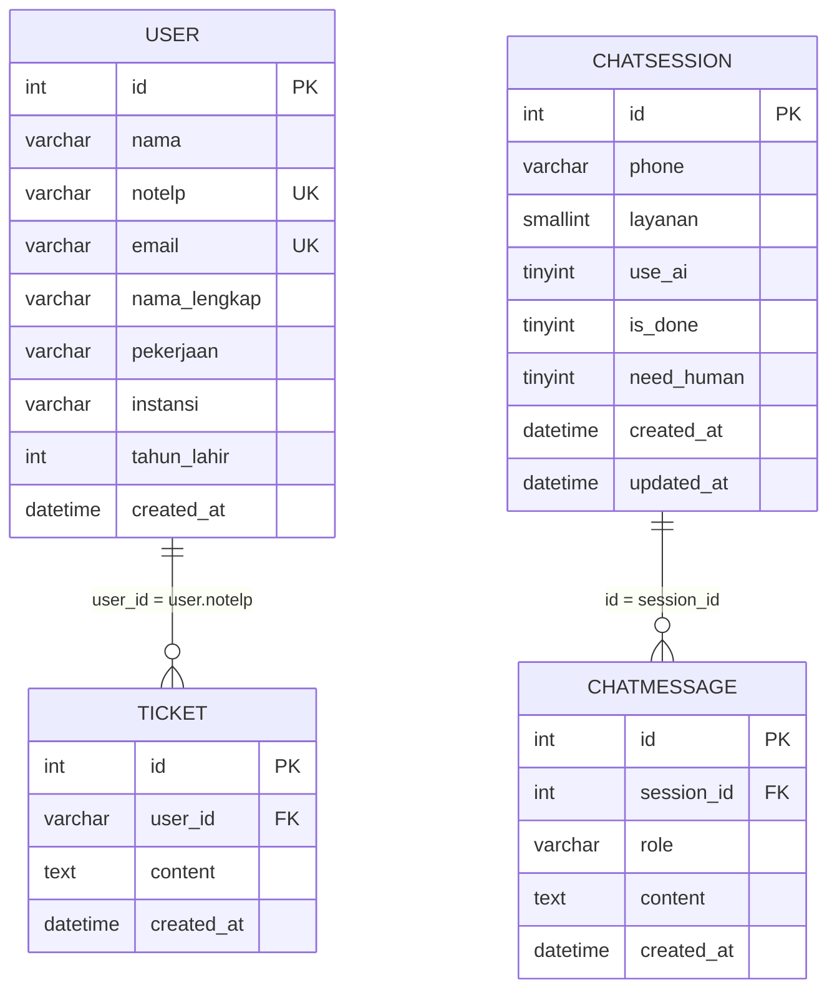

### 8.2 Relasi yang benar-benar ada

| Relasi | Kolom | Keterangan |
|---|---|---|
| `chatmessage` → `chatsession` | `session_id` → `chatsession.id` | Foreign key ada di dump SQL. |
| `ticket` → `user` | `user_id` → `user.notelp` | **Bukan** ke `user.id`; bertipe `varchar(15)`. |
| `chatsession.phone` → `user.notelp` | – | Hanya relasi logika (nilai sama), **tidak ada FK**. |

### 8.3 Definisi tabel dan pemetaan kolom

#### Tabel `user`

| Kolom | Tipe | Nullable | Diisi oleh | Nilai/Sumber |
|---|---|---|---|---|
| `id` | `int` | PK | DB | Auto increment. |
| `nama` | `varchar(255)` | NOT NULL | `b_graph/registrasi.py` | `message.pushName`. |
| `notelp` | `varchar(15)` | NOT NULL, UNIQUE | `b_graph/registrasi.py` | `message.phone`. |
| `email` | `varchar(255)` | NULL, UNIQUE | `b_graph/registrasi.py` | Form “Email :”, divalidasi. |
| `nama_lengkap` | `varchar(255)` | NULL | `b_graph/registrasi.py` | Form “Nama Lengkap :”. |
| `pekerjaan` | `varchar(255)` | NULL | `b_graph/registrasi.py` | Form “Pekerjaan :”. |
| `instansi` | `varchar(255)` | NULL | `b_graph/registrasi.py` | Form “Instansi/…”. |
| `tahun_lahir` | `int` | NOT NULL | `b_graph/registrasi.py` | Form “Tahun Lahir :”. |
| `created_at` | `datetime` | NOT NULL | Model default | `datetime.now()`. |

#### Tabel `chatsession`

| Kolom | Tipe | Default | Diubah oleh | Nilai |
|---|---|---|---|---|
| `id` | `int` | PK | DB | Auto increment. |
| `phone` | `varchar(15)` | – | `get_or_create_active_session` | Nomor WhatsApp. |
| `layanan` | `smallint` | `0` | `set_layanan` | `0` belum pilih, `1` konsultasi, `2` pengaduan, `3` chat AI. |
| `use_ai` | `tinyint(1)` | `0` | **Tidak pernah diubah** | Selalu `0`. |
| `is_done` | `tinyint(1)` | `0` | `main_chat`, tasks idle, close 24 jam, pilih layanan yang sama | `0` aktif, `1` selesai. |
| `need_human` | `tinyint(1)` | `0` | **Tidak pernah diubah** | Selalu `0`. |
| `created_at` | `datetime` | `now()` | Model default | Dipakai TTL 24 jam. |
| `updated_at` | `datetime` | `now()` saat insert | **Tidak diperbarui otomatis** | Tidak mencerminkan perubahan terakhir. |

#### Tabel `chatmessage`

| Kolom | Tipe | Nullable | Diisi oleh | Nilai |
|---|---|---|---|---|
| `id` | `int` | PK | DB | Auto increment. |
| `session_id` | `int` | NULL | `main.py :: process`, `graph/main.py :: main_chat` | FK `chatsession.id`. |
| `role` | `varchar(10)` | NOT NULL | Sama | `user` atau `bot`. |
| `content` | `text` | NOT NULL | Sama | Teks; untuk gambar: `"{file_path} {teks}"`. |
| `created_at` | `datetime` | NOT NULL | Model default | `datetime.now()`. |

#### Tabel `ticket`

| Kolom | Tipe | Diisi oleh | Nilai |
|---|---|---|---|
| `id` | `int` | DB | Auto increment. |
| `user_id` | `varchar(15)` | `b_graph/complaint.py :: create_ticket` | `user.notelp` (nomor HP). |
| `content` | `text` | `create_ticket` | Gabungan pesan dengan `\n`. |
| `created_at` | `datetime` | Model default | `datetime.now()`. |

> **Penting:** `create_ticket()` tidak dipanggil di alur mana pun. Pada dump contoh, tabel `ticket` tidak memiliki baris data.

### 8.4 Siklus hidup sesi

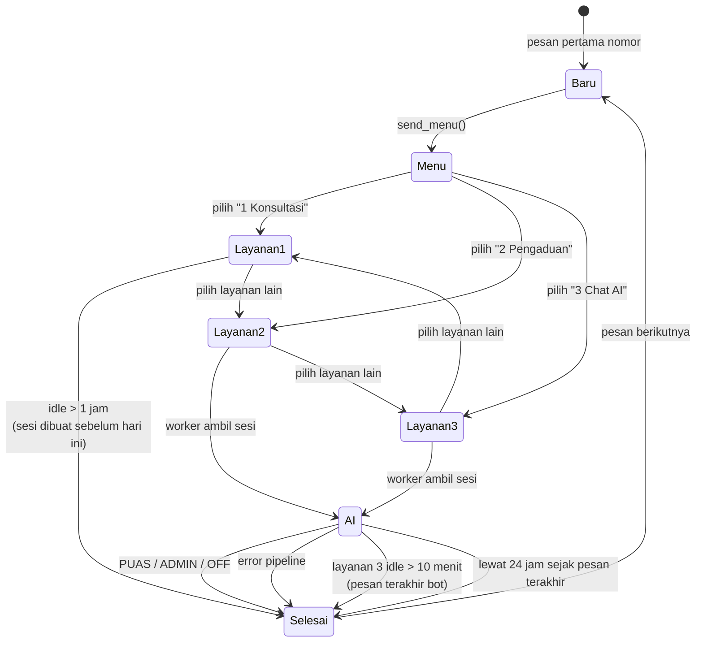

Catatan:

- Memilih layanan **berbeda** hanya meng-**update** kolom `layanan` pada baris `chatsession` yang sama. Tidak ada baris sesi baru.
- Baris sesi baru hanya dibuat jika user memilih layanan **yang sama** dengan layanan sesi saat ini (sesi lama di-`is_done = 1`, lalu `get_or_create_active_session` membuat baris baru).
- `is_done = 1` juga terjadi saat memilih layanan yang sama, idle, atau `close_24_hour`.
- `get_active_session()` menolak sesi yang `created_at`-nya lebih dari 24 jam, sehingga sesi baru dibuat walaupun `is_done` masih `0`.
- Setelah sesi selesai, pesan berikutnya akan memicu menu lagi.

### 8.5 Fungsi database dan tugas latar belakang

| Fungsi | File | Tugas |
|---|---|---|
| `get_or_create_active_session(phone)` | `db/models.py:40` | Cari sesi aktif; jika tidak ada, INSERT sesi baru. |
| `get_active_session(phone)` | `db/models.py:51` | Sesi dengan `is_done=0` dan `created_at >= now-24 jam`. |
| `get_user_by_phone(phone)` | `db/models.py:66` | SELECT user berdasarkan `notelp`. |
| `load_last_messages(session)` | `db/models.py:75` | Mengambil riwayat berprefix; **tidak dipakai**. |
| `get_active_session_not_arr(ids)` | `db/models.py:144` | Query sesi siap diproses worker AI. |
| `iddle_task_ai(ids)` | `db/models.py:116` | Tutup sesi layanan 3 yang idle > 10 menit dan pesan terakhir bot; kirim `send_end_session`. |
| `iddle_task_konsultasi()` | `db/models.py:91` | Tutup sesi layanan 1 yang dibuat sebelum hari ini dan idle > 1 jam. |
| `close_24_hour()` | `db/models.py:174` | Tutup semua sesi yang pesan terakhirnya > 24 jam; dipanggil saat startup. |

Tugas per menit (`main.py:292`):

```text
setiap 60 detik:
├─ iddle_task_ai(session_in_works_id)
└─ iddle_task_konsultasi()
```

### 8.6 Data contoh pada dump

Dari `wa7600_db.sql`:

- `chatsession` berisi 84 baris; mayoritas `layanan = 3`.
- `use_ai` dan `need_human` **selalu `0`**.
- `chatmessage` hanya berisi `role = 'user'` dan `'bot'`; tidak ada `'sis'`.
- `content` untuk jawaban bergambar diawali path lokal, misalnya:
  `/home/bpssulbar/api-data/data/IMAGES/BRS/.../3.jpg ...`
- `ticket` tidak memiliki baris.
- Nomor yang muncul didominasi `6282195195502`, sesuai nilai default whitelist.

---

## 9. Pipeline Ingest Data (Populate)

### 9.1 Perintah CLI

`backend.py` memakai `argparse`:

| Perintah | Fungsi | Hasil |
|---|---|---|
| `python backend.py --create_db` | `db/init_db.py :: init_db()` | Membuat tabel `user`, `chatsession`, `chatmessage`, `ticket`. |
| `python backend.py --download_pdf_list` | `populate/download_pdf.py :: download_pdf_list()` | Daftar publikasi & BRS dari API BPS → JSON (`PDF_JSON`). |
| `python backend.py --download_pdf` | `download_pdf_main()` | Unduh PDF publikasi (tahun ≥ 2010) dan BRS tahun berjalan. |
| `python backend.py --populate_daftar` | `populate_pdf_list.py :: populate_daftar_pdf()` | Abstrak publikasi/BRS → Chroma `:8092`. |
| `python backend.py --populate_pdf` | `populate_pdf.py :: populate_pdf()` | Isi PDF tahun berjalan → Chroma `:8090`. |
| `python backend.py --populate_table` | `populate_data.py :: populate_table()` | Tabel statistik BPS → Chroma `:8091`. |
| `python backend.py --populate_image` | `populate_image.py :: populate_image()` | PDF → JPG per halaman untuk referensi gambar. |
| `python backend.py --start_chat` | `main_chat_cmd()` | Uji chat di terminal tanpa WhatsApp. |
| `python backend.py --query` | – | Argumen ada, tetapi **belum diimplementasikan**. |

### 9.2 Diagram pipeline

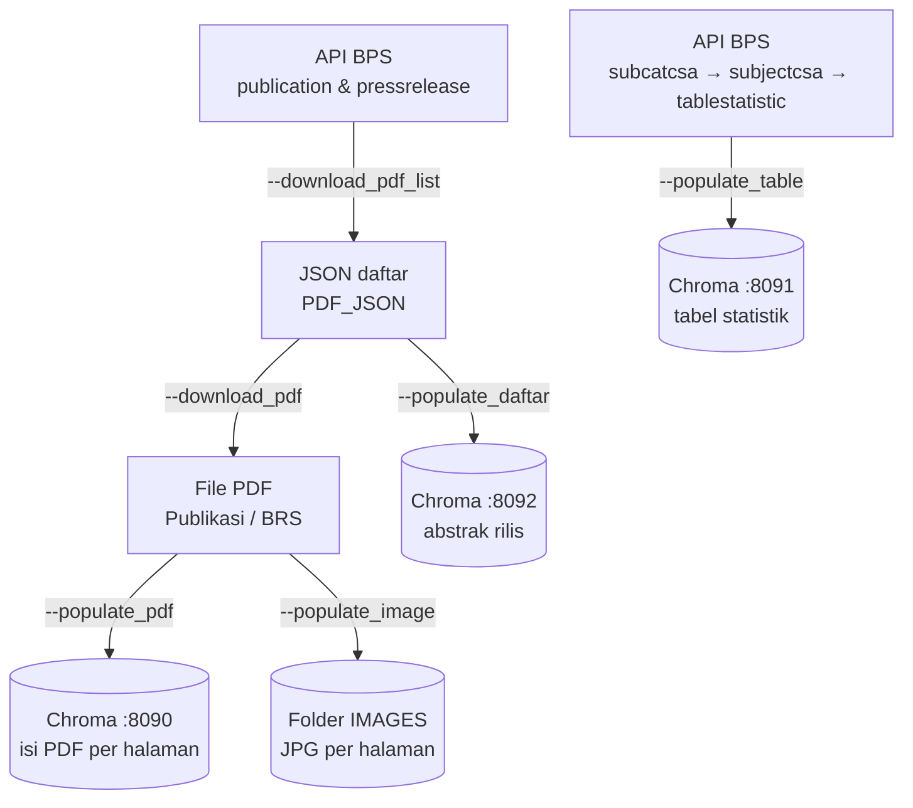

### 9.3 Koleksi Chroma dan isinya

| Koleksi | Port | Path lokal | Isi | ID dokumen | Metadata penting |
|---|---|---|---|---|---|
| `isi_pdf` | `8090` | `chroma/isi_pdf` | Chunk teks PDF publikasi & BRS tahun berjalan. | `{source}:{page}:{chunk_index}` | `pub_id`/`brs_id`, `title`, `rl_date`, `source`, `page`, `issn`/`subj` |
| `table` | `8091` | `chroma/table` | Deskripsi tabel dan teks data tabel statistik. | `{subcat_id}-{sub_id}-{table_id}` (+ `-{tahun}` untuk tipe 2/3) | `tipe`, `judul`, `subcat_id`, `sub_id`, `table_id`, `sumber`, `tahun` |
| `daftar_rilis_publikasi` | `8092` | `chroma/daftar_rilis_publikasi` | Abstrak publikasi dan BRS. | `{rl_date}---{pub_id/brs_id}` | `tipe`, `id`, `rl_date`, `updt_date` |

Embedding untuk ketiga koleksi:

```python
OllamaEmbeddings(
    model="nomic-embed-text-v2-moe",
    base_url=os.getenv("OLLAMA_BASE_URL", "http://localhost:11434")
)
```

> Ollama harus berjalan saat populate **dan** saat query, karena `_global.py` mengimpor fungsi embedding.

### 9.4 Detail `download_pdf.py`

1. `download_pdf_list()` memanggil API BPS:
   - `/v1/api/list/model/publication/domain/7600/page/{page}/key/{API_KEY}/`
   - `/v1/api/list/model/pressrelease/domain/7600/page/{page}/key/{API_KEY}/`
   - Menyimpan seluruh halaman ke `PDF_JSON`.
2. `download_file_batch()` menentukan file yang perlu diunduh:
   - Publikasi: `rl_date` tahun ≥ 2010.
   - BRS: `rl_date` tahun berjalan.
3. Nama file:
   - Publikasi: `{rl_date}-{title}.pdf`
   - BRS: `{rl_date}-{brs_id}-{subj}.pdf`
   - Karakter ilegal diganti `_`; nama di-ASCII-kan.
4. Download memakai **thread**, 50 file per batch, jeda 4 detik antar batch.
5. File yang sudah ada dilewati.

### 9.5 Detail `populate_pdf.py`

- Hanya memproses PDF dengan `rl_date` **tahun berjalan**.
- `PyPDFLoader(mode="page")` → satu `Document` per halaman.
- Metadata ditambahkan: `pub_id`/`brs_id`, `title`, `rl_date`, `updt_date`, `issn`/`subj`.
- `RecursiveCharacterTextSplitter(chunk_size=800, chunk_overlap=150)`.
- Jika terjadi error, chunk size dikurangi 50 dan dicoba ulang.
- ID chunk: `{source}:{page}:{index}`.
- `PATH_LAST` ditulis, tetapi resume otomatis tidak aktif karena `MULAI_ENBED = True` selalu.

### 9.6 Detail `populate_pdf_list.py`

- Membaca `PDF_JSON`.
- Publikasi: satu dokumen per publikasi, isi = judul + abstrak.
- BRS: deduplikasi berdasarkan `brs_id`; jika ada beberapa versi, dipilih `rl_date` terbaru, lalu `updt_date` terbaru.
- Abstrak BRS dibersihkan dari HTML; isi `<li>` diambil sebagai poin.
- ID: `{rl_date}---{id}`.
- Metadata: `tipe`, `id`, `rl_date`, `updt_date`.

### 9.7 Detail `populate_data.py`

Alur:

```text
get_categories()  → /list/model/subcatcsa/domain/7600
  └─ get_subjects(subcat, page) → /list/model/subjectcsa/domain/7600/subcat/{id}
       └─ get_table(subject, page) → /list/model/tablestatistic/domain/7600/subject/{id}
            ├─ tablesource == "1" (Static Table)
            │    → dokumen metadata saja
            ├─ tablesource == "2" (Dynamic Table)
            │    → get_detail_table(id, 2, rentang tahun)
            │    → json_to_text_2() → dokumen per tahun
            └─ tablesource == "3" (SIMDASI)
                 → get_detail_table(id, 3, rentang tahun)
                 → json_to_text_3() → dokumen per tahun
```

- `tablesource = 1`: konten hanya deskripsi (judul, kategori, subyek, cakupan waktu, jenis sumber), belum berisi nilai.
- `tablesource = 2`: mengambil daftar variabel, tahun, lalu data per variabel/tahun; membentuk key `vervar+var+turvar+tahun+turtahun` untuk membaca `datacontent`.
- `tablesource = 3`: mengambil data per tahun dari endpoint `year/{tahun}`.
- `populate_table()` memberi jeda 3 detik per kategori.

### 9.8 Detail `populate_image.py`

- Hanya PDF tahun berjalan.
- `pdf2image.convert_from_path(path, 200)` → JPG per halaman.
- Disimpan ke `IMAGES_FOLDER_Publikasi` / `IMAGES_FOLDER_BRS`, dengan nama `1.jpg`, `2.jpg`, dst.
- Folder yang sudah ada dilewati.
- Path inilah yang dipakai `RagPublikasiBRS.file_path` dan dikirim lewat `send_simple_image`.

### 9.9 Endpoint API BPS yang dipakai

Domain `7600` = Provinsi Sulawesi Barat.

| Endpoint | Dipakai untuk |
|---|---|
| `/v1/api/list/model/publication/...` | Daftar publikasi. |
| `/v1/api/list/model/pressrelease/...` | Daftar BRS. |
| `/v1/api/list/model/subcatcsa/...` | Kategori/subjek. |
| `/v1/api/list/model/subjectcsa/...` | Subjek per kategori. |
| `/v1/api/list/model/tablestatistic/...` | Daftar tabel statistik. |
| `/v1/api/view/model/tablestatistic/.../id/{id}` | Detail tabel / daftar variabel. |
| `/v1/api/list/model/th/.../var/{var}` | Daftar tahun per variabel. |
| `/v1/api/list/model/data/.../var/{var}/th/{tahun}` | Data per variabel/tahun. |
| `/v1/api/view/model/tablestatistic/.../year/{tahun}/id/{id}` | Data tabel SIMDASI per tahun. |

### 9.10 Panduan praktis mengisi ChromaDB (dari nol)

Bagian ini adalah langkah operasional untuk mengisi ketiga koleksi Chroma. Semua perintah dijalankan **dari root project** (`api-data`), karena path di `.env` bersifat relatif.

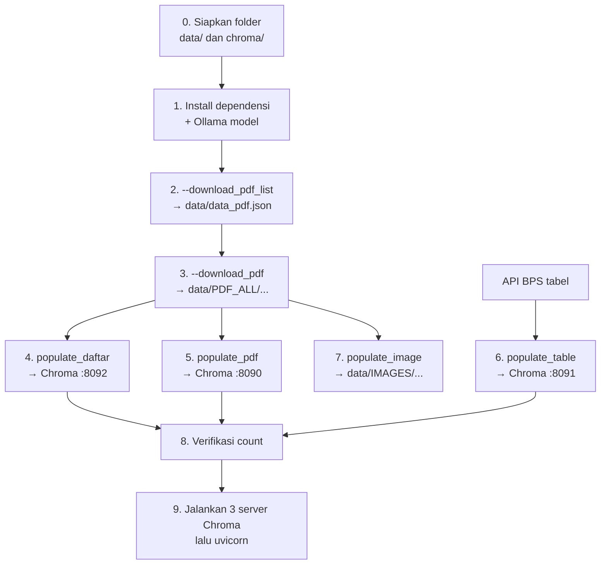

#### Prasyarat

| Kebutuhan | Cara cek | Catatan |
|---|---|---|
| Python + venv | `python3 -V` | Gunakan venv agar `chroma` dan `uvicorn` tersedia. |
| Dependensi | `pip show chromadb` | Jika kosong: `pip install -r requirements.txt`. |
| Ollama | `curl -s localhost:11434/api/tags` | Harus hidup saat populate dan saat aplikasi query. |
| Model embedding | `ollama list` | Harus ada `nomic-embed-text-v2-moe`. |
| Poppler | `pdftoppm -v` | Dibutuhkan `pdf2image` untuk `--populate_image`. |
| Key BPS | cek `.env` → `API_BPS` | Dipakai download dan populate tabel. |

#### Langkah 0 — Siapkan folder

Folder `data/` dan `chroma/` belum ada di repo, jadi harus dibuat dulu. Nama folder harus sama dengan `.env`:

```bash
mkdir -p data/PDF_ALL/Publikasi data/PDF_ALL/BRS \
         data/IMAGES/Publikasi data/IMAGES/BRS \
         chroma/isi_pdf chroma/table chroma/daftar_rilis_publikasi
```

#### Langkah 1 — Install dependensi dan model embedding

```bash
python3 -m venv venv
source venv/bin/activate
pip install -r requirements.txt

ollama pull nomic-embed-text-v2-moe
```

#### Langkah 2 — Unduh daftar publikasi dan BRS

```bash
python backend.py --download_pdf_list
```

Hasil: `data/data_pdf.json` berisi dua array, `publication` dan `pressrelease`, dari seluruh halaman API BPS (jeda 1 detik per halaman).

#### Langkah 3 — Unduh file PDF

```bash
python backend.py --download_pdf
```

| Jenis | Filter | Folder tujuan |
|---|---|---|
| Publikasi | `rl_date` tahun ≥ 2010 | `data/PDF_ALL/Publikasi` |
| BRS | `rl_date` tahun berjalan | `data/PDF_ALL/BRS` |

Cek jumlah file sebelum lanjut:

```bash
ls data/PDF_ALL/Publikasi | wc -l
ls data/PDF_ALL/BRS | wc -l
```

#### Langkah 4 — Isi ketiga koleksi Chroma

Ada dua cara. **Cara A lebih aman** karena menulis langsung ke folder tanpa server Chroma memegang database, sehingga tidak ada risiko `database is locked`.

**Cara A — panggil modul populate langsung (rekomendasi).**

Modul populate hanya mengimpor `populate/get_embedding_function.py`, bukan `_global.py`, jadi **tidak butuh server Chroma** saat menulis:

```bash
# :8092 — abstrak publikasi & BRS (paling cepat, hanya dari JSON)
python -c "from populate.populate.populate_pdf_list import populate_daftar_pdf; populate_daftar_pdf()"

# :8090 — isi PDF per halaman (lama, embedding per chunk)
python -c "from populate.populate.populate_pdf import populate_pdf; populate_pdf()"

# :8091 — tabel statistik dari API BPS (paling lama, ratusan request)
python -c "from populate.populate.populate_table import populate_table; populate_table()"

# folder IMAGES — JPG per halaman untuk sitasi gambar
python -c "from populate.populate.populate_image import populate_image; populate_image()"
```

**Cara B — lewat `backend.py`.**

`backend.py` mengimpor `graph.main` → `_global`, yang langsung membuat koneksi ke ketiga port Chroma. Jadi **ketiga server harus sudah berjalan** lebih dulu:

```bash
# terminal 1, 2, 3
chroma run --path ./chroma/isi_pdf --port 8090
chroma run --path ./chroma/table --port 8091
chroma run --path ./chroma/daftar_rilis_publikasi --port 8092

# terminal lain
python backend.py --populate_daftar
python backend.py --populate_pdf
python backend.py --populate_table
python backend.py --populate_image
```

> Jika muncul error lock SQLite pada Cara B, hentikan server port terkait, ulangi perintah populate, lalu jalankan server lagi. Cara A menghindari masalah ini sepenuhnya.

| Perintah populate | Target | Perkiraan waktu |
|---|---|---|
| `populate_daftar_pdf` | `:8092` | Menit. |
| `populate_pdf` | `:8090` | Jam, tergantung jumlah PDF tahun berjalan. |
| `populate_table` | `:8091` | Jam, karena ada `sleep(3)` per halaman subjek + ratusan request API. |
| `populate_image` | folder `IMAGES` | Puluhan menit, tergantung jumlah halaman. |

Mengulang populate aman karena dokumen dikirim dengan `ids` eksplisit, sehingga Chroma melakukan upsert, bukan duplikasi. Hanya waktunya terbuang.

#### Langkah 5 — Verifikasi

```bash
python - <<'PY'
import chromadb

for port in (8090, 8091, 8092):
    client = chromadb.HttpClient(host="localhost", port=port)
    try:
        print(f"port {port}: koleksi =", [c.name for c in client.list_collections()])
        col = client.get_collection("langchain")
        print(f"port {port}: {col.count()} dokumen")
        contoh = col.peek(1)["documents"]
        if contoh:
            print("  contoh:", contoh[0][:180].replace("\n", " "))
    except Exception as e:
        print(f"port {port}: kosong / error -> {e}")
PY
```

Nama koleksi adalah **`langchain`** (default, karena kode tidak mengisi `collection_name`) di masing-masing server. Yang membedakan hanya port dan folder datanya.

#### Langkah 6 — Nyalakan server dan aplikasi

```bash
chroma run --path ./chroma/isi_pdf --port 8090
chroma run --path ./chroma/table --port 8091
chroma run --path ./chroma/daftar_rilis_publikasi --port 8092

uvicorn main:app --reload --port 8080
```

`--path` **wajib** menunjuk folder yang sama dengan `CHROMA_PATH_*` saat populate. Jika berbeda, server akan terlihat kosong walaupun data sudah ditulis.

### 9.11 Khusus macOS

`how to run.txt` dan `note.txt` memakai path Windows (`D:\Yan\Code\api-data`). Di macOS, path tersebut **tidak bisa dipakai** dan perintah `start`/`cmd` juga tidak ada. Ikuti langkah berikut.

#### Persiapan sekali jalan

```bash
# 1. Homebrew (jika belum ada)
/bin/bash -c "$(curl -fsSL https://raw.githubusercontent.com/Homebrew/install/HEAD/install.sh)"

# 2. Poppler untuk pdf2image (--populate_image)
brew install poppler

# 3. Masuk folder project
cd ~/side-project/api-data

# 4. Virtual environment + dependensi
python3 -m venv venv
source venv/bin/activate
pip install --upgrade pip
pip install -r requirements.txt

# 5. Pastikan binary tersedia di venv
which python
which chroma
```

Jika `which chroma` kosong, berarti venv belum aktif atau `chromadb` belum terpasang:

```bash
source venv/bin/activate
pip install chromadb
```

#### Ollama di macOS

Ollama berjalan sebagai aplikasi/daemon, bukan service otomatis:

```bash
# opsi 1: aplikasi Ollama (buka dari Applications)
open -a Ollama

# opsi 2: jalankan daemon di terminal terpisah
ollama serve

# tarik model embedding (sekali saja)
ollama pull nomic-embed-text-v2-moe

# verifikasi
ollama list
curl -s http://localhost:11434/api/tags | head -c 200
```

#### Menjalankan beberapa proses di macOS

Buka **tab/terminal terpisah** (macOS tidak punya perintah `start` seperti Windows):

```bash
# terminal 1
cd ~/side-project/api-data && source venv/bin/activate
chroma run --path ./chroma/isi_pdf --port 8090

# terminal 2
cd ~/side-project/api-data && source venv/bin/activate
chroma run --path ./chroma/table --port 8091

# terminal 3
cd ~/side-project/api-data && source venv/bin/activate
chroma run --path ./chroma/daftar_rilis_publikasi --port 8092

# terminal 4
cd ~/side-project/api-data && source venv/bin/activate
uvicorn main:app --reload --port 8080

# terminal 5 (tunnel untuk webhook Wablas)
ngrok http 8080
```

Cek port sedang dipakai atau tidak:

```bash
lsof -nP -iTCP:8090 -sTCP:LISTEN
lsof -nP -iTCP:8080 -sTCP:LISTEN
```

Hentikan proses dengan `Ctrl+C` di terminalnya, atau:

```bash
lsof -ti tcp:8090 | xargs kill
```

#### Catatan khusus macOS

| Hal | Windows (`how to run.txt`) | macOS |
|---|---|---|
| Path | `D:\Yan\Code\api-data` | `~/side-project/api-data` |
| Pemisah path | `\` | `/` |
| Beberapa terminal | `start "nama" cmd /k` | buka tab Terminal baru |
| Python | `python` | `python3` (atau `python` setelah venv aktif) |
| Poppler | biasanya sudah ada | wajib `brew install poppler` |
| Port sibuk | `netstat -ano` | `lsof -nP -iTCP:8090` |
| Chroma path | `.\chroma\isi_pdf` | `./chroma/isi_pdf` |

> Di macOS, jika folder `data/` atau `chroma/` belum ada, populate akan membuatnya sebagian, tetapi folder gambar dan PDF sebaiknya disiapkan lebih dulu dengan `mkdir -p` seperti pada Langkah 0.

### 9.12 Masalah umum saat populate

| Gejala | Penyebab | Solusi |
|---|---|---|
| `database is locked` | Server Chroma sedang memegang folder yang sama saat populate menulis langsung. | Hentikan server port tersebut, ulangi populate, lalu nyalakan lagi. Atau pakai Cara A. |
| `port 8090` berisi 0 dokumen | PDF tahun berjalan tidak ada, atau `--path` server berbeda dengan path populate. | Cek `ls data/PDF_ALL/Publikasi`; pastikan `--path ./chroma/isi_pdf`. |
| `Connection refused` ke `:11434` | Ollama belum jalan. | `ollama serve` / buka aplikasi Ollama. |
| `model "nomic-embed-text-v2-moe" not found` | Model belum ditarik. | `ollama pull nomic-embed-text-v2-moe`. |
| `Unable to get page count. Is poppler installed?` | Poppler belum ada. | `brew install poppler` (macOS). |
| `ModuleNotFoundError: chromadb` | Venv tidak aktif atau dependensi belum dipasang. | `source venv/bin/activate && pip install -r requirements.txt`. |
| `chroma: command not found` | Venv tidak aktif. | Aktifkan venv, cek `which chroma`. |
| API BPS balas `Error` / 401 | `API_BPS` salah atau kuota habis. | Perbarui key di `.env`. |
| Hanya sebagian PDF masuk | `populate_pdf` hanya memproses tahun berjalan (`datetime.now().year`). | Sesuai desain; PDF tahun lain tidak di-embed. |
| Populate tabel terasa berhenti | `sleep(3)` per halaman subjek + retry API. | Biarkan berjalan; pantau log. |

---

## 10. Konfigurasi, Cara Menjalankan, dan Batas Operasional

### 10.1 Variabel environment

Nilai rahasia tidak ditampilkan di dokumen ini.

| Kelompok | Variabel | Kegunaan |
|---|---|---|
| Database | `DB_HOST`, `DB_PORT`, `DB_DATABASE`, `DB_USERNAME`, `DB_PASSWORD` | Koneksi MySQL. |
| Wablas | `WABLAS_TOKEN`, `WABLAS_SECRET_KEY` | Autentikasi Wablas (`TOKEN.SECRET`). |
| Gemini/LLM | `Whatsapp7600_01_Api_KEY` | Klasifikasi `checker`. |
| | `Whatsapp7600_02_Api_KEY` | Ekstraksi pertanyaan. |
| | `Whatsapp7600_04_Api_KEY` | Jawaban akhir. |
| | `Whatsapp7600_03_Api_KEY`, `_05_`, `_06_` | Pool scoring/rerank. |
| BPS | `API_BPS` | Key `webapi.bps.go.id`. |
| Chroma | `CHROMA_PORT_ISI_PDF`, `CHROMA_PORT_TABLE`, `CHROMA_PORT_RILIS_PUBLIKASI` | Port `8090`, `8091`, `8092`. |
| | `CHROMA_PATH_ISI_PDF`, `CHROMA_PATH_TABLE`, `CHROMA_PATH_DAFTAR` | Path persistensi saat populate. |
| Ollama | `OLLAMA_BASE_URL` | Default `http://localhost:11434`. |
| File | `PDF_JSON`, `PATH_LAST`, `DATA_PATH` | Daftar PDF, checkpoint, folder data. |
| | `PDF_ALL_FOLDER_Publikasi`, `PDF_ALL_FOLDER_BRS` | Folder PDF. |
| | `IMAGES_FOLDER_Publikasi`, `IMAGES_FOLDER_BRS` | Folder gambar halaman. |
| Whitelist | `ALLOWED_GROUP_NUMBERS` | Daftar nomor yang diproses, dipisah koma. **Jika kosong, default hanya `6282195195502`.** |
| Tidak dipakai | `MINIO_*` | Tidak terlihat dipakai di kode. |
| Tidak dipakai | `LLM_MODEL` | Model di-hardcode di `graph/llm.py`. |

### 10.2 Urutan menjalankan

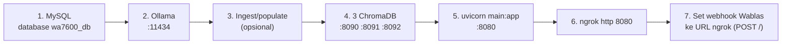

Perintah umum:

```bash
pip install -r requirements.txt
python backend.py --create_db

# Ingest (contoh)
python backend.py --download_pdf_list
python backend.py --download_pdf
python backend.py --populate_daftar
python backend.py --populate_pdf
python backend.py --populate_table
python backend.py --populate_image

# Jalankan ChromaDB
chroma run --path chroma/isi_pdf --port 8090
chroma run --path chroma/table --port 8091
chroma run --path chroma/daftar_rilis_publikasi --port 8092

# Jalankan API
uvicorn main:app --reload --port 8080
ngrok http 8080
```

> `how to run.txt` memakai path Windows (`D:\Yan\Code\api-data`) dan `note.txt` memakai path Windows. Sesuaikan dengan OS/server. Di produksi Linux, path contohnya `/home/bpssulbar/api-data`.
>
> Langkah lengkap mengisi ChromaDB ada di [9.10](#910-panduan-praktis-mengisi-chromadb-dari-nol). Persiapan dan perintah khusus macOS ada di [9.11](#911-khusus-macos).

### 10.3 Perilaku startup dan shutdown

`main.py:321` (`lifespan`):

1. `await close_24_hour()` — menutup sesi yang idle > 24 jam.
2. Membuat task `debounce_per_user_worker()`.
3. Membuat task `process_per_minute()`.
4. `yield` — aplikasi melayani request.
5. Saat shutdown:
   - batalkan kedua worker;
   - `await debounce.shutdown()` — batalkan semua timer;
   - tunggu task selesai.

Saat import:

- `main.py` memanggil `build_graph()`.
- `_global.py` membuat 3 koneksi Chroma HTTP.
- Karena itu, konfigurasi Chroma dan embedding harus siap sebelum aplikasi dijalankan.

### 10.4 Health check

`GET /text`

```json
{
  "status": true,
  "active_session": 0,
  "debounce_user": 0
}
```

- `active_session` = jumlah sesi AI yang sedang berjalan (`session_in_works_id`).
- `debounce_user` = jumlah nomor yang sedang punya buffer debounce.

### 10.5 Batas, timeout, dan cache

| Parameter | Nilai | Lokasi |
|---|---|---|
| Debounce per nomor | 2 detik | `main.py` |
| Worker memilih sesi | tiap 1 detik | `main.py` |
| Maksimal sesi AI bersamaan | 4 | `main.py` |
| Jeda minimal sebelum sesi diambil | 5 detik sejak pesan terakhir | `db/models.py` |
| Deduplikasi pesan | 200 ID terakhir | `main.py` |
| Panjang chunk untuk rerank | 25.000 karakter | `graph/nodes/rerank.py` |
| Limit API key rerank | 10 request/60 detik per key | `graph/nodes/rerank.py` |
| Cooldown key gagal | 20 detik | `graph/nodes/rerank.py` |
| Timeout LLM utama | 60 detik | `graph/llm.py` |
| Timeout LLM tanpa config | 30 detik | `graph/llm.py` |
| Timeout data tabel live | 60 detik | `graph/nodes/rag.py` |
| Jeda antar pesan jawaban | 3 detik | `graph/main.py` |
| TTL sesi aktif | 24 jam sejak `created_at` | `db/models.py` |
| Idle chat AI | 10 menit (pesan terakhir bot) | `db/models.py` |
| Idle konsultasi | 1 jam, sesi dibuat sebelum hari ini | `db/models.py` |
| Close sesi 24 jam | saat startup | `db/models.py` |
| Chunk PDF | 800 karakter, overlap 150 | `populate/populate_pdf.py` |
| Resolusi gambar | 200 dpi | `populate/populate_image.py` |
| Cache API BPS | 15 menit | `graph/rag/retriever.py` |
| Cache hari libur | per tahun | `b_graph/check_working.py` |

---

## 11. Cheat Sheet “Siapa Memanggil Siapa”

| Pemanggil | Fungsi yang dipanggil | Tujuan | Efek |
|---|---|---|---|
| Wablas | `main.py :: wablas()` | Menerima webhook. | – |
| `wablas()` | `debounce.push()` | Menggabungkan pesan per nomor. | Buffer in-memory. |
| `DebounceManager._timer()` | `DebounceManager.process()` | Memproses batch setelah 2 detik. | – |
| `process()` | `db.models.get_user_by_phone()` | Cek user terdaftar. | SELECT `user`. |
| `process()` | `b_graph.set_layanan.set_layanan()` | Sesi + menu + layanan. | INSERT/UPDATE `chatsession`. |
| `set_layanan()` | `db.models.get_or_create_active_session()` | Cari/buat sesi. | INSERT `chatsession`. |
| `set_layanan()` | `b_graph.check_working.check_work_status()` | Cek jam kerja/libur. | HTTP tanggalmerah. |
| `set_layanan()` | `wablas.send.send_menu()` | Kirim menu. | HTTP Wablas. |
| `set_layanan()` | `wablas.send.send_simple_text()` | Kirim pesan info. | HTTP Wablas. |
| `process()` | `b_graph.registrasi.registrasi()` | Form & validasi user. | INSERT `user`. |
| `registrasi()` | `wablas.send.send_simple_text()` | Kirim form/error. | HTTP Wablas. |
| `process()` | `b_graph.start_layanan.start_layanan()` | Sapaan layanan. | HTTP Wablas. |
| `process()` | `db.models.ChatMessage.aio_create()` | Simpan pesan user. | INSERT `chatmessage`. |
| Worker | `db.models.get_active_session_not_arr()` | Cari sesi siap AI. | SELECT `chatsession` + `chatmessage`. |
| Worker | `graph.main.main_chat()` | Jalankan AI. | – |
| `main_chat()` | `graph.main.graph.ainvoke()` | Menjalankan LangGraph. | – |
| `checker` | `graph.llm.llm_query()` | Klasifikasi pesan. | HTTP LLM. |
| `checker` | `wablas.send.send_simple_text()` | Pesan “Mohon tunggu”. | HTTP Wablas. |
| `pecah_question...` | `graph.llm.llm_query()` | Ekstraksi pertanyaan. | HTTP LLM. |
| `rag_search` | `graph.rag.retriever.*` | Cari 4 sumber. | Chroma/DDG/BPS. |
| `rag_rerank` | `graph.nodes.rerank.fetch_chunk_score()` | Scoring chunk. | HTTP LLM. |
| `rag_rerank` | `graph.rag.retriever.get_content_rag_data_table_tahun()` | Ambil data tabel live. | HTTP BPS + LLM. |
| `rag_answer` | `graph.llm.llm_query()` | Susun jawaban akhir. | HTTP LLM. |
| `main_chat()` | `wablas.send.send_simple_text/image()` | Kirim jawaban. | HTTP Wablas. |
| `main_chat()` | `db.models.ChatMessage.aio_create()` | Simpan jawaban bot. | INSERT `chatmessage`. |
| `process_per_minute()` | `db.models.iddle_task_ai()` | Tutup sesi AI idle. | UPDATE `chatsession`, HTTP Wablas. |
| `process_per_minute()` | `db.models.iddle_task_konsultasi()` | Tutup sesi konsultasi idle. | UPDATE `chatsession`. |
| `lifespan` | `db.models.close_24_hour()` | Tutup sesi 24 jam. | UPDATE `chatsession`. |
| `backend.py` | `populate.*` | Ingest knowledge base. | Chroma/file. |
| `backend.py` | `graph.main.main_chat_cmd()` | Chat terminal. | – |

---

## 12. Temuan Teknis dan Catatan Keamanan

> Bagian ini adalah hasil pembacaan kode, **bukan perubahan kode**. Beberapa temuan perlu diverifikasi di lingkungan produksi.

### 12.1 Potensi bug / perilaku yang perlu diperhatikan

| No | Lokasi | Temuan | Dampak |
|---|---|---|---|
| 1 | `main.py :: checkHpGroup` + `.env` | `ALLOWED_GROUP_NUMBERS` tidak diset di `.env`; default hanya `6282195195502`. | Nomor lain tidak dilayani sama sekali. Untuk produksi, isi daftar nomor yang benar. |
| 2 | `main.py :: debounce_per_user_worker` | Riwayat di-`reverse()` menjadi terbaru→terlama. `new_message` berisi pesan terbaru lebih dulu, tetapi `checker` memakai `new_chat[-1]` (pesan paling lama dalam batch). | Klasifikasi PUAS/TANYA/ADMIN/OFF bisa salah saat user mengirim beberapa pesan sekaligus. |
| 3 | `b_graph/complaint.py` | `create_ticket()` tidak pernah dipanggil. | Layanan 2 (Pengaduan) hanya dijawab AI; tabel `ticket` selalu kosong. |
| 4 | `db/models.py` | `use_ai` dan `need_human` tidak pernah diubah. | Kolom selalu `0`; tidak ada penanda “butuh manusia”. |
| 5 | `graph/main.py :: main_chat` | Pesan penutup PUAS/ADMIN/OFF tidak disimpan ke `chatmessage`. | Riwayat di database tidak memuat balasan penutup. |
| 6 | `graph/main.py :: main_chat` | Pada blok `except`, kode memakai `user.notelp`. Jika `user` bernilai `None`, handler error ikut gagal. | Pesan permintaan maaf tidak terkirim; error hanya di log. |
| 7 | `wablas/send.py` | `send_simple_image` dan `send_menu` melakukan retry `while True` tanpa jeda dan tanpa batas. | Jika Wablas error, request bisa berulang sangat cepat dan membebani API. |
| 8 | `populate/download_pdf.py` | `download_file()` juga retry tanpa batas saat HTTP != 200; `range_split()` bisa `IndexError` jika daftar unduhan kosong. | Proses ingest bisa macet atau crash. |
| 9 | `b_graph/check_working.py` | `is_holiday` menangkap `requests.exceptions.RequestException`, padahal request memakai `httpx`. | Jika API tanggal merah gagal, exception httpx naik dan pesan user bisa tidak diproses. |
| 10 | `db/models.py` | `updated_at` hanya diisi saat INSERT; tidak diperbarui saat `save()`. | Tidak bisa dipakai untuk melihat waktu perubahan terakhir sesi. |
| 11 | `graph/llm.py` | Model `gemma-4-31b-it` di-hardcode; `LLM_MODEL` di `.env` tidak dipakai. | Mengganti model harus mengedit kode. |
| 12 | `graph/nodes/checker.py` | Retry 4× tanpa jeda jika output bukan salah satu kategori. | Berpotensi menghabiskan kuota/kena rate limit. |
| 13 | `populate/populate_pdf.py` | `MULAI_ENBED = True` selalu; `PATH_LAST` ditulis tetapi tidak dibaca. | Fitur resume tidak berfungsi. |
| 14 | `populate/test_rag.py` | `from query_data import query_rag` tidak ada di repo. | Tes tidak bisa dijalankan. |
| 15 | `backend.py` | Argumen `--query` tidak punya implementasi. | Perintah tidak berfungsi. |
| 16 | `db/models.py` | `load_last_messages()` tidak dipanggil. | Kode mati. |
| 17 | `_global.py` | `session_in_works = Cache(...)` tidak dipakai; yang dipakai `session_in_works_id` di `main.py`. | Cache tidak berfungsi sebagai state bersama. |
| 18 | `graph/state.py` | `user_is_db`, `use_ai` dideklarasikan tetapi tidak dipakai. | Tidak ada efek. |
| 19 | `b_graph/registrasi.py` | `tahun_lahir` hanya dicek digit, tanpa rentang wajar. Email duplikat memicu pesan error generik. | Data bisa tidak valid; pesan error membingungkan. |
| 20 | `graph/main.py :: main_chat` | Jawaban disimpan ke DB setelah semua pesan dikirim. Jika proses berhenti di tengah, sebagian jawaban tidak tercatat. | Riwayat DB bisa tidak lengkap. |
| 21 | `wablas/send.py :: send_simple_text` | Tidak ada retry; error langsung `return None`. | Pesan bisa hilang saat gangguan jaringan singkat. |
| 22 | `graph/rag/retriever.py` | Pencarian PDF hanya mencakup PDF tahun berjalan karena filter di `populate_pdf.py`. | Pertanyaan data lama tidak menemukan isi PDF lama, kecuali lewat tabel/rilis. |
| 23 | `graph/nodes/rag.py` | `get_rag_data_arr` dan tabel memakai filter keyword substring. Jika keyword hasil LLM buruk, dokumen relevan bisa terbuang. | Kualitas jawaban sangat bergantung pada node ekstraksi. |

### 12.2 Keamanan

| No | Temuan | Saran |
|---|---|---|
| 1 | `.env` berisi token Wablas, API key LLM, API key BPS, dan password database dalam teks biasa. | Jangan commit `.env`; rotasi key yang pernah terekspos; gunakan secret manager. |
| 2 | `populate/api_bps.py` menulis API key BPS langsung di kode dan melakukan request saat di-import. | Pindahkan ke `.env`; jangan jalankan saat import. |
| 3 | Webhook `POST /` tidak memverifikasi asal request (tidak ada signature/token). | Tambahkan secret token di URL/header dan validasi di awal endpoint. |
| 4 | `ALLOWED_GROUP_NUMBERS` adalah satu-satunya filter nomor. | Pastikan daftar diisi dengan benar; jangan mengandalkan default. |
| 5 | `GET /text` terbuka tanpa autentikasi. | Batasi akses atau tambahkan auth jika diekspos publik. |

### 12.3 Catatan operasional

- Data PDF dan gambar yang dipakai sebagai referensi hanya untuk **tahun berjalan**. Saat tahun berganti, jalankan ulang `--populate_pdf` dan `--populate_image`.
- `populate_*` menulis ke folder Chroma lokal. Hindari menjalankan populate bersamaan dengan server Chroma yang membaca folder yang sama; jalankan ingest terlebih dahulu, lalu start/restart Chroma.
- `send_simple_image` membuka file gambar dari path lokal. Jika `--populate_image` belum dijalankan, pengiriman gambar referensi akan gagal dan `main_chat` menangkapnya sebagai error.
- `session_in_works_id` hanya ada di memori. Setelah restart, sesi yang sedang diproses bisa diambil ulang oleh worker.
- Semua waktu kerja memakai zona `Asia/Makassar` (WITA).
- Layanan 1 tidak mengirim notifikasi ke petugas; pesan hanya tersimpan di `chatmessage` untuk dibaca manual.

---

## 13. Contoh Trace Lengkap Satu Pertanyaan

Misalkan user mengirim:

> “Minta data kemiskinan Sulawesi Barat tahun 2025”

### Langkah 1 — Webhook

```json
{
  "id": "wablas-msg-001",
  "pushName": "Budi",
  "isGroup": false,
  "message": "Minta data kemiskinan Sulawesi Barat tahun 2025",
  "phone": "62812xxxx",
  "timestamp": "2026-11-11T10:00:00"
}
```

`main.py :: wablas()`:

- bukan grup;
- nomor ada di whitelist;
- pesan tidak kosong;
- `id` belum pernah diproses;
- `debounce.push("62812xxxx", payload)`.

### Langkah 2 — Debounce

Tidak ada pesan baru selama 2 detik → `process("62812xxxx", [payload])`.

### Langkah 3 — Sesi dan layanan

`get_user_by_phone` → user sudah ada (mis. hasil registrasi sebelumnya).

`set_layanan`:

- sesi aktif `layanan = 3`;
- pesan bukan pilihan menu → tidak ada perubahan layanan;
- `stop = False`, `send_start_layanan = False`.

`registrasi`:

- user sudah ada → langsung lanjut.

`ChatMessage.aio_create`:

```sql
INSERT INTO chatmessage (session_id, role, content, created_at)
VALUES (87, 'user', 'Minta data kemiskinan Sulawesi Barat tahun 2025', NOW());
```

### Langkah 4 — Worker

Setelah > 5 detik dan tidak ada pesan baru:

- `get_active_session_not_arr` menemukan sesi `layanan = 3`, `is_done = 0`, pesan terakhir `user`.
- Worker mengambil semua `chatmessage` sesi.
- `new_message = ["Minta data kemiskinan Sulawesi Barat tahun 2025"]`.
- `older_message = [...]`.
- `main_chat` dijalankan.

### Langkah 5 — `checker`

Karena ini interaksi AI pertama (belum ada balasan bot di sesi ini), `chat_history` kosong:

- tidak memanggil LLM;
- `check = TANYA`;
- kirim “Mohon tunggu sebentar … 1–10 menit”.

### Langkah 6 — Ekstraksi

LLM menghasilkan kira-kira:

```json
[
  {
    "pertanyaan_asli": "Data Persentase Penduduk Miskin di Sulawesi Barat tahun 2025 dan 2026",
    "kueri_pencarian": [
      "Persentase Penduduk Miskin Garis Kemiskinan Sulawesi Barat 2025 2026",
      "kemiskinan penduduk miskin Sulawesi Barat 2025 2026"
    ],
    "keyword": [
      "Persentase", "Penduduk", "Miskin", "kemiskinan",
      "Sulawesi", "Barat", "2025", "2026"
    ]
  }
]
```

### Langkah 7 — Pencarian

Empat task paralel:

1. DuckDuckGo `site:bps.go.id` → artikel/halaman BPS.
2. Chroma `:8090` → chunk PDF publikasi/BRS tentang kemiskinan.
3. Chroma `:8091` → tabel “Persentase Penduduk Miskin …”.
4. Chroma `:8092` → abstrak rilis “Persentase Penduduk Miskin …”.

Hanya hasil yang memuat keyword yang dipakai.

### Langkah 8 — Rerank

Chunk digabung maksimal 25.000 karakter, lalu LLM memberi skor:

```json
[
  {
    "id": "uuid-tabel-1",
    "score": 100,
    "jawaban": "Persentase Penduduk Miskin Sulawesi Barat September 2025 sebesar 10,18 persen."
  },
  {
    "id": "uuid-pdf-1",
    "score": 72,
    "jawaban": "Data kemiskinan menurut kabupaten ..."
  }
]
```

Karena ada `score = 100` pada kandidat `RagData`, sistem mengambil data tabel live dari API BPS untuk tahun 2025/2026, lalu LLM mengekstrak jawaban per chunk tabel.

Item dengan `score > 1` disimpan ke `rag_data_output` / `rag_publikasi_brs_output` / `rag_rilis_publikasi_output` / `ddgs_output`.

### Langkah 9 — Jawaban akhir

`rag_answer` menyusun konteks dari `urutan_rag`, memanggil LLM, dan mendapat:

```json
{
  "jawaban": "*📊 DATA STATISTIK TERKINI* ... *Indikator:* Persentase Penduduk Miskin ... *Nilai:* 10,18% ...",
  "sitasi": ["uuid-pdf-1", "uuid-tabel-1"]
}
```

Untuk sitasi yang bertipe `RagPublikasiBRS`, ditambahkan `AnswerModel(type="file", file_path=".../IMAGES/.../5.jpg", text="Referensi Dokumen: ..., Hal 5")`. Lalu ditambahkan `AnswerModel(type="text", text=jawaban)`.

### Langkah 10 — Kirim dan simpan

`main_chat`:

1. `send_simple_image` untuk gambar referensi (jika ada).
2. `send_simple_text` untuk teks jawaban.
3. `send_simple_text` untuk disclaimer `*AI dapat membuat kesalahan`.
4. Jeda 3 detik antar item.
5. `INSERT chatmessage` untuk gambar referensi: `role = "bot"`, `content = "{file_path} {teks}"`.
6. `INSERT chatmessage` untuk teks: `role = "bot"`, `content = teks`.

Hasil akhir di database:

```text
chatsession:
  id=87, phone=62812xxxx, layanan=3, is_done=0

chatmessage:
  id=..., session_id=87, role='user', content='Minta data kemiskinan ...'
  id=..., session_id=87, role='bot',  content='.../5.jpg Referensi Dokumen: ..., Hal 5'
  id=..., session_id=87, role='bot',  content='*📊 DATA STATISTIK TERKINI* ...'
```

Jika user kemudian membalas “terima kasih”:

- `checker` (dengan riwayat tidak kosong) → `PUAS`;
- `main_chat` mengirim pesan terima kasih;
- `UPDATE chatsession SET is_done = 1 WHERE id = 87`;
- **tidak ada** `chatmessage` baru untuk pesan penutup.

---

## 14. Glosarium

| Istilah | Arti |
|---|---|
| **Webhook** | Endpoint HTTP yang dipanggil Wablas saat ada pesan masuk. |
| **Debounce** | Menunda proses sampai tidak ada pesan baru selama jangka waktu tertentu. |
| **Session** | Satu percakapan aktif antara satu nomor dan layanan. |
| **Layanan** | Jenis kebutuhan user: konsultasi, pengaduan, atau chat AI. |
| **RAG** | Retrieval-Augmented Generation: mengambil dokumen relevan, lalu LLM menjawab berdasarkan dokumen itu. |
| **Chunk** | Potongan teks dokumen yang disimpan di vector store. |
| **Embedding** | Representasi vektor dari teks untuk pencarian semantik. |
| **Vector store** | Database vektor (di sini ChromaDB). |
| **MMR** | Maximal Marginal Relevance: pencarian yang mengurangi hasil redundan. |
| **Rerank** | Menilai ulang dan mengurutkan kandidat dokumen dengan LLM. |
| **Sitasi** | ID dokumen yang dipakai sebagai rujukan jawaban. |
| **BRS** | Berita Resmi Statistik. |
| **Publikasi** | Dokumen publikasi BPS (PDF). |
| **SIMDASI** | Sumber tabel statistik tipe 3 pada API BPS. |
| **Idle** | Sesi tidak ada aktivitas dalam jangka waktu tertentu. |
| **TTL** | Time-to-live; batas umur sesi (24 jam). |

---

*Dokumen ini menjelaskan kondisi kode saat ini. Jika kode diubah, bagian alur, nama fungsi, dan pemetaan kolom perlu diperbarui.*
